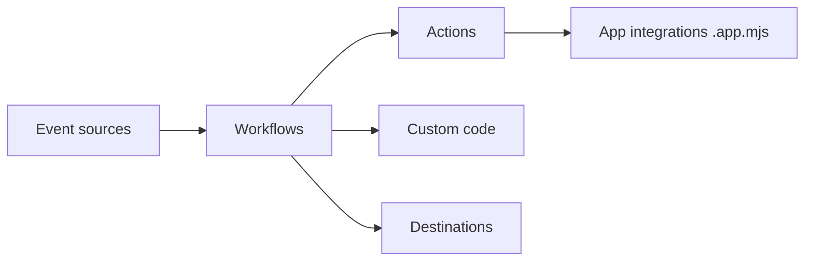

# PipedreamHQ/pipedream

> Event-driven integration platform with ready-made components, for developers who connect applications.

## The problem
Connecting SaaS applications and reacting to their events requires a lot of authentication code and plumbing.

## What it actually does
Workflows: sequences of steps (actions or Node.js, Python, Go, Bash code) triggered by an event. Event sources, actions, destinations (S3, Snowflake, HTTP, email, SSE). The repo mostly contains the integration components (more than 1,000 apps claimed), the roadmap and the documentation; the workflow engine is not in it.

## How it is wired


## Trying it
```javascript
export default {
  name: "http",
  version: "0.0.1",
  props: { http: "$.interface.http" },
  run(event) { console.log(event); },
};
```

## Cost and gotchas
Free tier with execution limits, then paid tiers. The engine is hosted by Pipedream. License not identified by GitHub. The README cites both 1,000+ and 500+ integrations.

## What it is not
Not self-hostable according to this README: the repo contains the components, not the platform.

## Alternatives
Not documented: the README does not name any alternative.

## For you
Worth watching: handy for quickly connecting services to a data pipeline; you depend on a hosted platform and a license to be checked.
