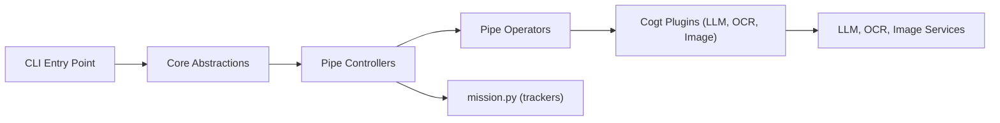

# Pipelex/pipelex

> Declarative language and Python CLI for defining typed, replayable LLM pipelines, for AI developers.

## The problem
Hand-coded prompt chains are hard to reproduce, poorly typed and difficult to share between models.

## What it actually does
You describe "methods" in `.mthds` files (TOML): LLM pipes, OCR extraction, sequences, batches, with typed concepts. Pipelex routes to more than 60 models, parses structured outputs and orchestrates. The same file runs in the CLI, Python, a REST API, MCP or n8n.

## How it is wired


## Trying it
```bash
npm install -g mthds
mthds-agent bootstrap
pipelex init
pipelex doctor
uv tool install pipelex
pipelex run bundle cv_batch_screening.mthds --inputs inputs.json
```

## Cost and gotchas
API keys from your providers, or the Pipelex Gateway (free credits, one key), or local models (Ollama, vLLM…). The Gateway sends back technical data (model names, tokens, latency), not the prompts; you disable it by using your own keys.

## What it is not
Not an autonomous agent framework: you declare the structure yourself. The hosted runner `api.pipelex.com` is in private beta. The license is not recognized by GitHub.

## Alternatives
No alternative cited in the README.

## For you
Worth watching: the idea of typed, versioned pipelines speaks to MLOps teams, but the license must be read before any enterprise use.
