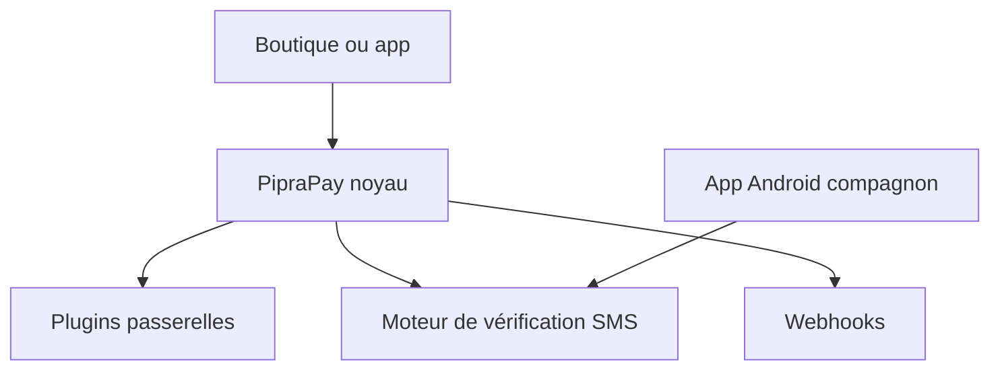

# PipraPay/PipraPay

> Self-hosted plugin-based payment platform that verifies mobile payments by SMS in South Asia.

## The problem
In regions without Stripe or PayPal, many wallets have no API: verification is done by hand, via SMS.

## What it actually does
A single system that groups payment gateways, wallets and APIs, with an SMS verification engine, webhooks and a REST API. Plugins add new gateways without touching the core. A companion Android app helps with verification. Architecture and language: not documented in the README.

## How it is wired
Simplified diagram based on the sheet, no diagram provided.

## Trying it
No command in the README: it points to help.piprapay.com and piprapay.readme.io.

## Cost and gotchas
Self-hosted, so server and security are on you. You need accounts with the gateways used. Last push in May 2026, i.e. more than five months before today's date but less than a year.

## What it is not
Not a worldwide Stripe competitor: targeted at Bangladesh, India and Pakistan. The "first" open source system of its kind is a README claim, unverified. AGPL license: obligations if you expose it as a service.

## Alternatives
No alternative named in the README.

## For you
Ignore: regional payments, outside the data / AI / MLOps scope.
