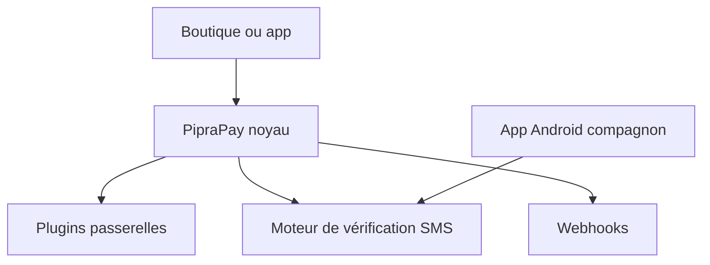

# PipraPay/PipraPay

> Plateforme de paiement auto-hébergée à plugins, qui vérifie des paiements mobiles par SMS en Asie du Sud.

## Le problème
Dans des régions sans Stripe ni PayPal, beaucoup de portefeuilles n'ont pas d'API : la vérification se fait à la main, par SMS.

## Ce que ça fait vraiment
Un seul système qui regroupe passerelles de paiement, portefeuilles et API, avec un moteur de vérification par SMS, des webhooks et une API REST. Des plugins ajoutent de nouvelles passerelles sans toucher au noyau. Une application Android compagnon aide à la vérification. Architecture et langage : non documentés dans le README.

## Comment c'est branché
Schéma simplifié d'après la fiche, sans diagramme fourni.

## Essayer
Aucune commande dans le README : renvoi vers help.piprapay.com et piprapay.readme.io.

## Coût et pièges
Auto-hébergé, donc serveur et sécurité à ta charge. Il faut des comptes chez les passerelles utilisées. Dernier push en mai 2026, soit plus de cinq mois avant la date du jour mais moins d'un an.

## Ce que ce n'est pas
Pas un concurrent de Stripe à l'échelle mondiale : ciblé sur Bangladesh, Inde et Pakistan. Le « premier » système open source du genre est une affirmation du README, non vérifiée. Licence AGPL : obligations si tu l'exposes en service.

## Alternatives
Aucune alternative nommée dans le README.

## Pour toi
Ignorer : paiement régional, hors périmètre data / IA / MLOps.

