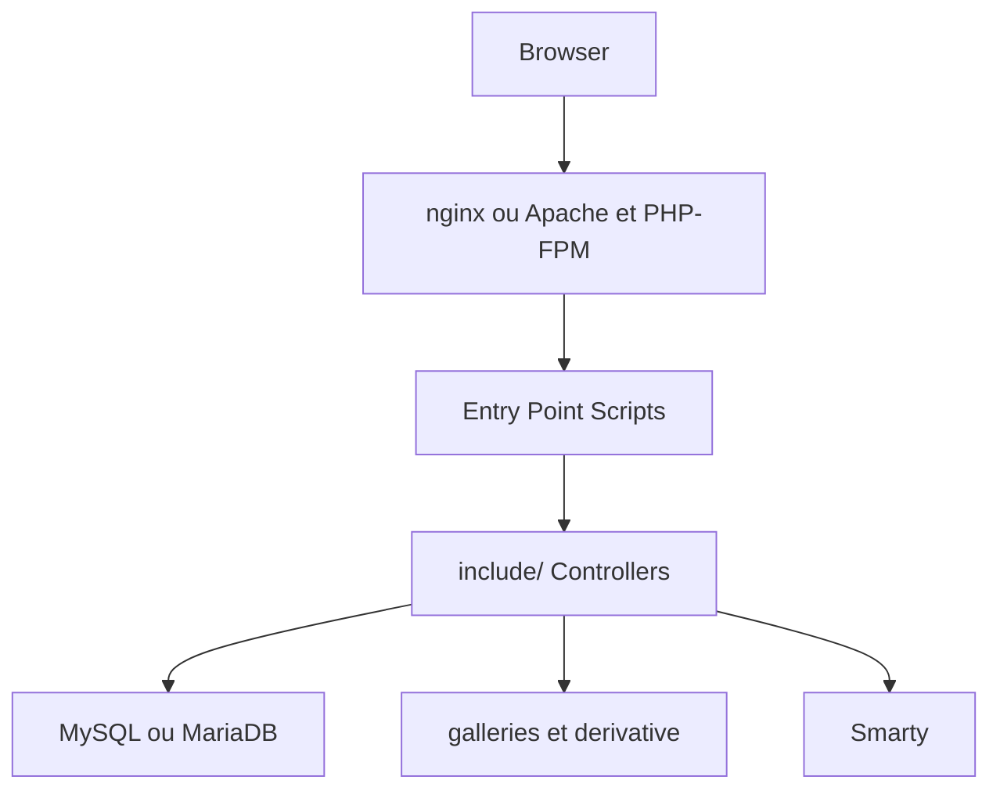

# Piwigo/Piwigo

> An open source, self-hosted web photo gallery, for individuals, teams and organizations.

## The problem
Sharing and organizing a large photo library without entrusting it to a third-party service.

## What it actually does
A monolithic PHP application: public interface, administration and API (ws.php) in JSON or XML-RPC. It stores metadata in MySQL or MariaDB, images in `galleries` and derivatives (thumbnails) in `derivative`. Plugins and themes extend the core; Smarty generates the HTML; GD or ImageMagick process the images.

## How it is wired


## Trying it
```bash
# Installation manuelle : télécharger l'archive, la transférer par FTP,
# puis ouvrir http://example.com/piwigo et suivre les étapes.
# Un guide d'installation Docker est lié depuis le README.
```

## Cost and gotchas
Free, GPL-2.0, but you need a web server, PHP 7.4 or later, MySQL or MariaDB and ImageMagick is recommended. End-of-life PHP versions expose you to vulnerabilities. 753 open issues. A paid cloud offering exists.

## What it is not
Not an image recognition or ML tool. The architecture mentions CDN, Redis or S3 as options, not required.

## Alternatives
No alternative named in the README.

## For you
Ignore: a PHP web gallery with no data, AI or MLOps component; useful only if you want to self-host your photos.
