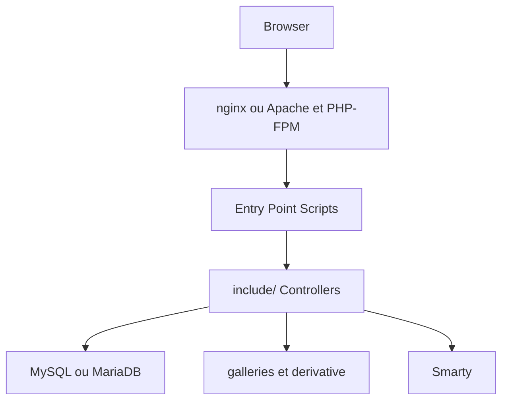

# Piwigo/Piwigo

> Galerie photo web open source à héberger soi-même, pour particuliers, équipes et organisations.

## Le problème
Partager et classer une grande photothèque sans la confier à un service tiers.

## Ce que ça fait vraiment
Application PHP monolithique : interface publique, administration et API (ws.php) en JSON ou XML-RPC. Elle stocke les métadonnées dans MySQL ou MariaDB, les images dans `galleries` et les dérivées (miniatures) dans `derivative`. Plugins et thèmes étendent le cœur ; Smarty génère le HTML ; GD ou ImageMagick traitent les images.

## Comment c'est branché


## Essayer
```bash
# Installation manuelle : télécharger l'archive, la transférer par FTP,
# puis ouvrir http://example.com/piwigo et suivre les étapes.
# Un guide d'installation Docker est lié depuis le README.
```

## Coût et pièges
Gratuit, GPL-2.0, mais il faut un serveur web, PHP 7.4 ou plus, MySQL ou MariaDB et ImageMagick conseillé. Les PHP en fin de vie exposent à des failles. 753 issues ouvertes. Une offre cloud payante existe.

## Ce que ce n'est pas
Pas un outil de reconnaissance d'images ni de ML. L'architecture mentionne CDN, Redis ou S3 comme options, non requises.

## Alternatives
Aucune alternative nommée dans le README.

## Pour toi
À ignorer : galerie web PHP sans composante data, IA ou MLOps ; utile seulement si tu veux auto-héberger tes photos.

