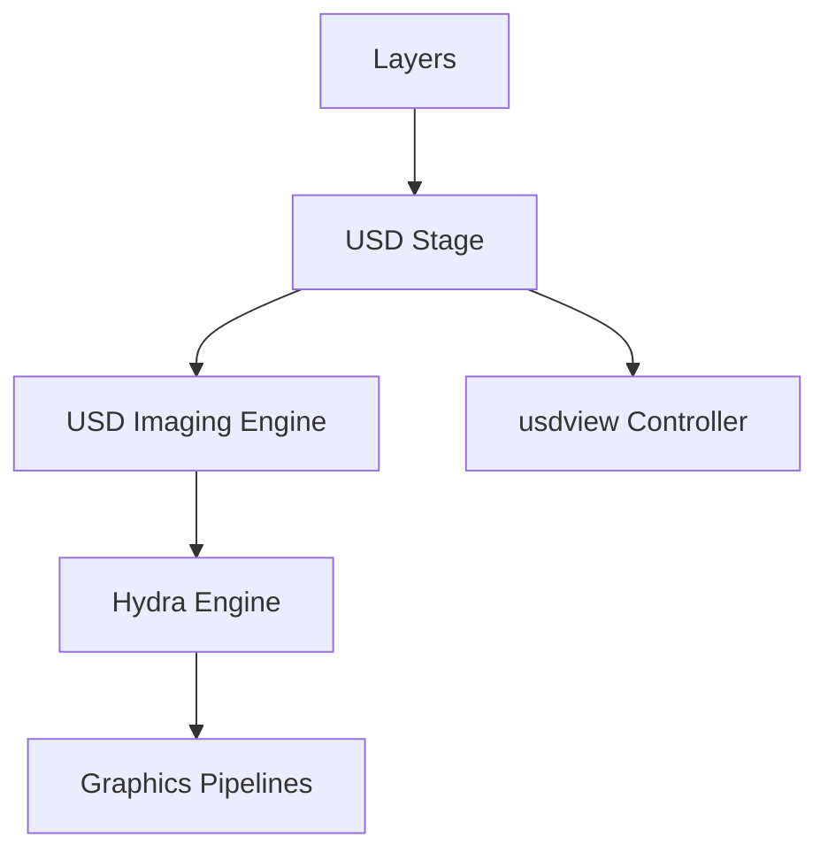

# PixarAnimationStudios/OpenUSD

> 3D scene description system for exchanging data between graphics applications.

## The problem
Studios and 3D tools have no common format to write, compose and distribute animated scenes.

## What it actually does
USD stores scenes in layers composed into a "stage", rendered by the Hydra engine to OpenGL or Vulkan. It provides Python bindings and the `usdview` tool, with builds possible for iOS, visionOS and WebAssembly.

## How it is wired


## Trying it
```bash
git clone https://github.com/PixarAnimationStudios/OpenUSD
python OpenUSD/build_scripts/build_usd.py /path/to/my_usd_install_dir
usdview OpenUSD/extras/usd/tutorials/convertingLayerFormats/Sphere.usda
```

## Cost and gotchas
Free, but a heavy build (C++ compiler, CMake, Intel TBB, Python for the bindings). The license is present but not identified by GitHub. 1,015 open issues.

## What it is not
Not a full rendering engine or a modeling application: it is an exchange format and framework.

## Alternatives
No alternative named in the README.

## For you
Worth watching: relevant if you generate or consume 3D scenes (synthetic data, simulation), otherwise off topic.
