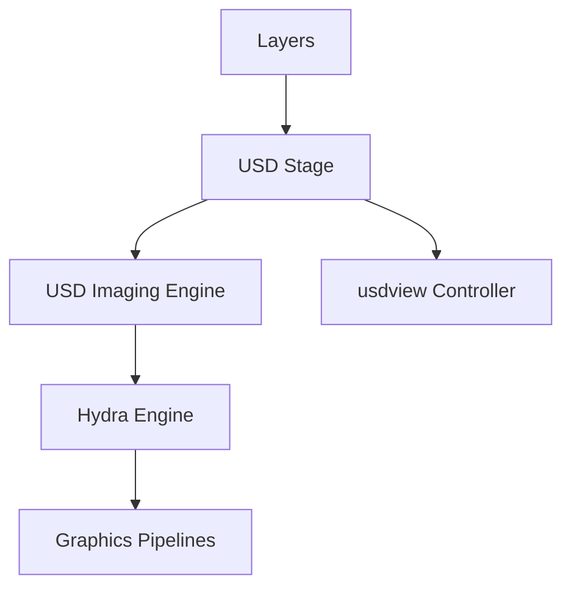

# PixarAnimationStudios/OpenUSD

> Système de description de scènes 3D pour échanger des données entre applications graphiques.

## Le problème
Les studios et outils 3D n'ont pas de format commun pour écrire, composer et diffuser des scènes animées.

## Ce que ça fait vraiment
USD stocke des scènes en couches composées en un « stage », rendues par le moteur Hydra vers OpenGL ou Vulkan. Il fournit les liaisons Python et l'outil `usdview`, avec compilation possible pour iOS, visionOS et WebAssembly.

## Comment c'est branché


## Essayer
```bash
git clone https://github.com/PixarAnimationStudios/OpenUSD
python OpenUSD/build_scripts/build_usd.py /path/to/my_usd_install_dir
usdview OpenUSD/extras/usd/tutorials/convertingLayerFormats/Sphere.usda
```

## Coût et pièges
Gratuit, mais compilation lourde (compilateur C++, CMake, Intel TBB, Python pour les liaisons). La licence est présente mais non identifiée par GitHub. 1 015 issues ouvertes.

## Ce que ce n'est pas
Ce n'est pas un moteur de rendu complet ni un logiciel de modélisation : c'est un format et un cadre d'échange.

## Alternatives
Aucune alternative nommée dans le README.

## Pour toi
À surveiller : pertinent si tu génères ou consommes des scènes 3D (données synthétiques, simulation), sinon hors sujet.

