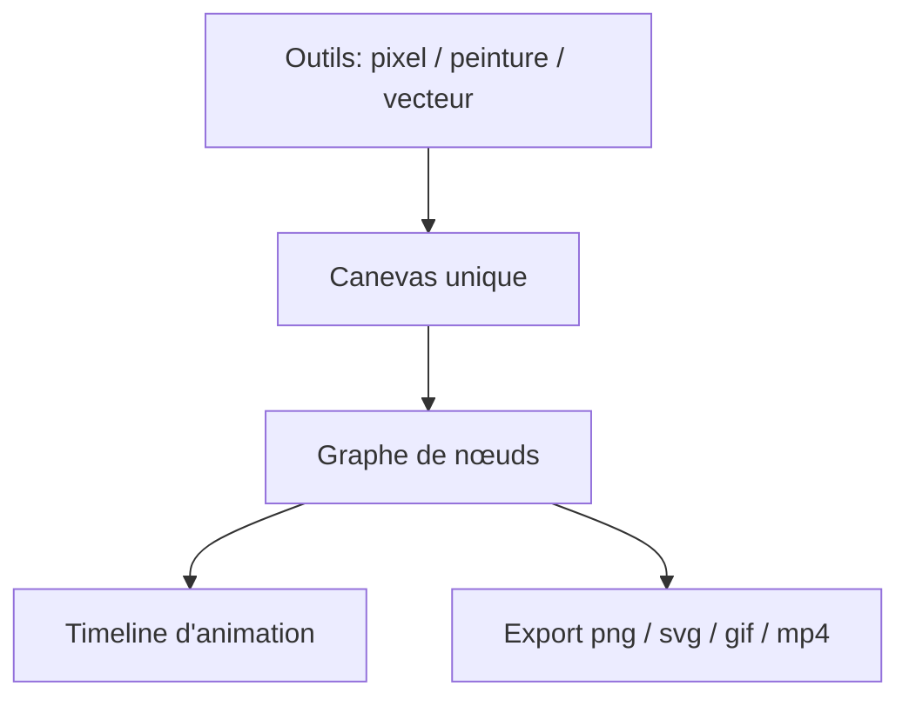

# PixiEditor/PixiEditor

> All-in-one 2D editor (pixel art, painting, vector, animation) for game and image creators.

## The problem
Mixing pixel art, retouching and vector work on a single canvas usually requires several programs.

## What it actually does
PixiEditor 2.0 offers three toolsets (pixel art, painting, vector) usable on a single canvas, a frame-by-frame animation timeline and a node system: layers and effects are nodes, with an exposed graph for procedural art. Exports to png, jpg, svg, gif, mp4.

## How it is wired
Simplified diagram based on the sheet, no diagram provided.


## Trying it
```bash
# Aucune commande dans le README : les sections
# "Building from source" et "Help" sont vides dans l'extrait fourni.
```

## Cost and gotchas
Free. The README details neither installation nor compilation. Keyframe vector animations are still on the roadmap.

## What it is not
Not an AI image generation tool: it is a manual editor.

## Alternatives
No alternative named in the README.

## For you
Ignore for your line of work: a graphics editor unrelated to data, AI or MLOps, except for the occasional sprite need.
