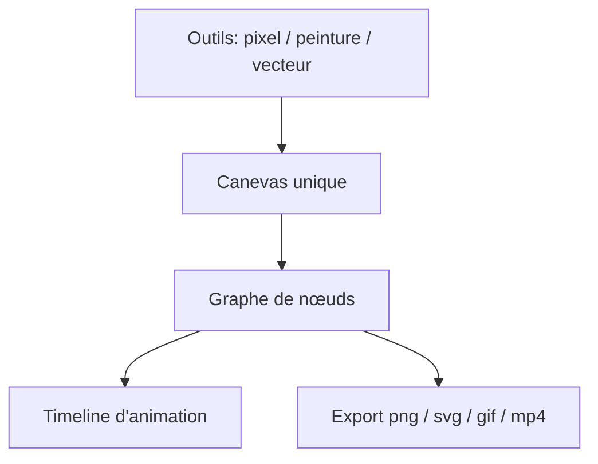

# PixiEditor/PixiEditor

> Éditeur 2D tout-en-un (pixel art, peinture, vecteur, animation) pour créateurs de jeux et d'images.

## Le problème
Mélanger pixel art, retouche et vecteur sur un même canevas demande d'ordinaire plusieurs logiciels.

## Ce que ça fait vraiment
PixiEditor 2.0 propose trois jeux d'outils (pixel art, peinture, vecteur) utilisables sur un seul canevas, une timeline d'animation image par image et un système de nœuds : calques et effets sont des nœuds, avec un graphe exposé pour l'art procédural. Export en png, jpg, svg, gif, mp4.

## Comment c'est branché
Schéma simplifié d'après la fiche, sans diagramme fourni.


## Essayer
```bash
# Aucune commande dans le README : les sections
# "Building from source" et "Help" sont vides dans l'extrait fourni.
```

## Coût et pièges
Gratuit. Le README ne détaille ni l'installation ni la compilation. Les animations vectorielles par images clés sont encore à la feuille de route.

## Ce que ce n'est pas
Ce n'est pas un outil de génération d'images par IA : c'est un éditeur manuel.

## Alternatives
Aucune alternative nommée dans le README.

## Pour toi
À ignorer pour ton métier : un éditeur graphique sans lien avec data, IA ou MLOps, sauf besoin ponctuel de sprites.

