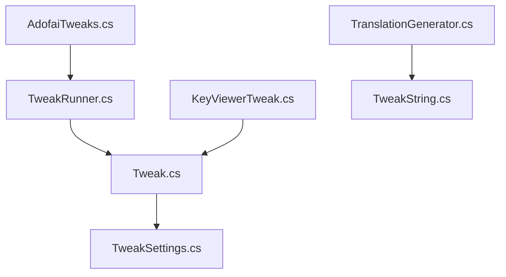

# PizzaLovers007/AdofaiTweaks

> UnityModManager mod that adds settings to the rhythm game A Dance of Fire and Ice.

## The problem
The game lacks options: planet colors, key limiter, hiding interface elements.

## What it actually does
A `TweakRunner` loads `Tweak` classes (key viewer, planet color and opacity, judgment visuals) that apply Harmony patches. A translation project is fed by a generator.

## How it is wired


## Trying it
```bash
# Pas de commande : installer UnityModManager, glisser le zip dans « Drop zip files here ».
# En jeu : Ctrl+F10 pour les réglages.
```

## Cost and gotchas
Free. Requires the game and UnityModManager.

## What it is not
Not a mod for other Unity games: it targets a single rhythm game. Nor is it a standalone tool; it installs into the game.

## Alternatives
No alternative named in the README.

## For you
Ignore: video game mod unrelated to data/AI.
