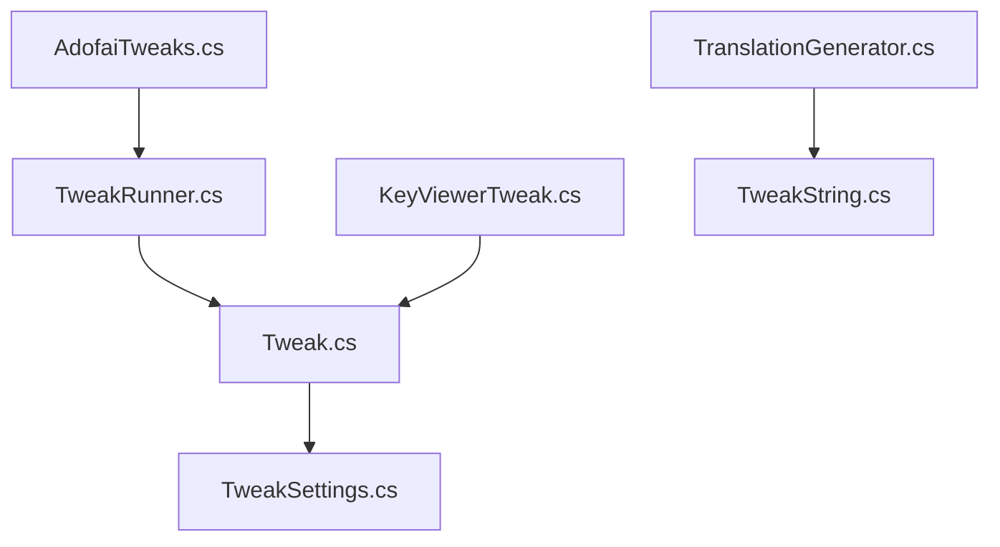

# PizzaLovers007/AdofaiTweaks

> Mod UnityModManager qui ajoute des réglages au jeu de rythme A Dance of Fire and Ice.

## Le problème
Le jeu manque d'options : couleur des planètes, limiteur de touches, masquage d'éléments d'interface.

## Ce que ça fait vraiment
Un `TweakRunner` charge des classes `Tweak` (visionneuse de touches, couleur et opacité des planètes, visuels de jugement) qui appliquent des patches Harmony. Un projet de traduction est alimenté par un générateur.

## Comment c'est branché


## Essayer
```bash
# Pas de commande : installer UnityModManager, glisser le zip dans « Drop zip files here ».
# En jeu : Ctrl+F10 pour les réglages.
```

## Coût et pièges
Gratuit. Nécessite le jeu et UnityModManager.

## Ce que ce n'est pas
Pas un mod pour d'autres jeux Unity : il cible un seul jeu de rythme. Ce n'est pas non plus un outil autonome, il s'installe dans le jeu.

## Alternatives
Aucune alternative nommée dans le README.

## Pour toi
À ignorer : mod de jeu vidéo sans lien avec data/IA.

