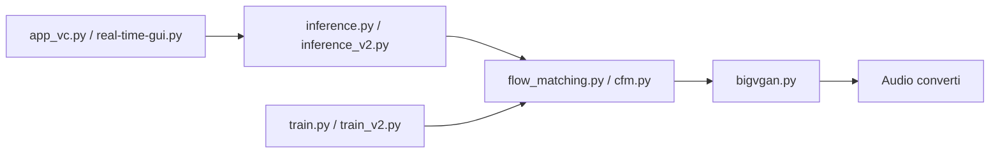

# Plachtaa/seed-vc

> Zero-shot voice and singing conversion, real time possible, from 1 to 30 seconds of reference.

## The problem
Cloning or converting a voice usually requires long training per speaker.

## What it actually does
Converts source speech to the voice of a reference audio, without training. Four models: v1 real-time (25M), v1 offline, v1 singing (44.1 kHz), v2 voice and accent. Fine-tuning is possible from a single utterance per speaker. Announced latency: ~300 ms of algorithm plus ~100 ms on the device side.

## How it is wired


## Trying it
```bash
pip install -r requirements.txt
python inference.py --source <source-wav> --target <referene-wav> --output <output-dir> --diffusion-steps 25
python app_vc.py --checkpoint <path-to-checkpoint> --config <path-to-config> --fp16 True
python real-time-gui.py --checkpoint-path <path-to-checkpoint> --config-path <path-to-config>
```

## Cost and gotchas
A GPU is strongly recommended for real time (measurements on a laptop RTX 3060). Weights are downloaded from Hugging Face on first launch.

## What it is not
Not a maintained product: the repository is archived, last push in April 2025. Voice impersonation use: the legal framework is your responsibility.

## Alternatives
The README compares with RVC and SoVITS (see EVAL.md).

## For you
Interesting for prototyping voice, but archived and copyleft: watch, do not build on it.
