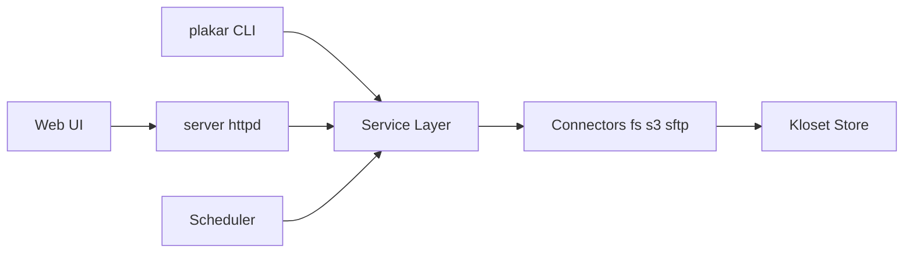

# PlakarKorp/plakar

> Open-source backup engine that is encrypted, deduplicated and verifiable, with a CLI and web interface.

## The problem
Backing up files, databases and objects with encryption, deduplication and verification without depending on a vendor.

## What it actually does
Creates snapshots in an immutable, encrypted (data and metadata) and deduplicated Kloset repository. Snapshots can be browsed, compared, verified without restoring, and restored file by file. Installable integrations (`plakar pkg add`) for PostgreSQL, MySQL, etcd, Kubernetes, S3. `.ptar` archives and synchronization between repositories.

## How it is wired


## Trying it
```bash
go install github.com/PlakarKorp/plakar@latest
plakar at /var/backups create
plakar at /var/backups backup /etc
plakar at /var/backups ls
plakar at /var/backups restore -to /tmp/restore <snapshot-id>
plakar at /var/backups ui
```

## Cost and gotchas
Free. Go 1.23.3 or later to build. Losing the encryption key means losing the backups (not detailed in the README).

## What it is not
Not a cloud service: you provide the storage. Database integrations go through packages you have to add.

## Alternatives
No alternative named in the README.

## For you
Worth watching: useful for backing up datasets and databases with verification, but test restoration before relying on it.
