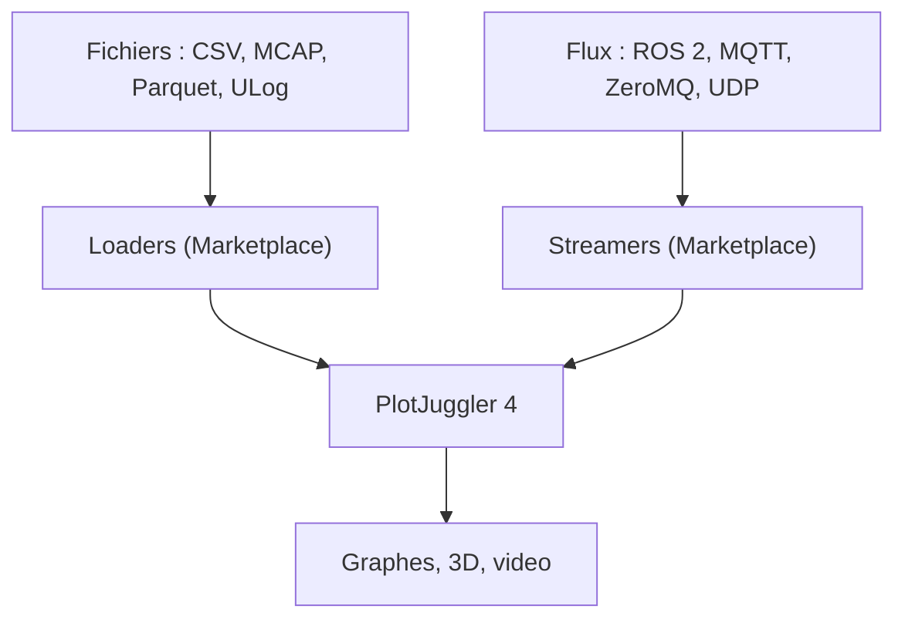

# PlotJuggler/PlotJuggler

> Application de visualisation de signaux temporels et multimodaux, pour comparer des enregistrements de capteurs et de robots.

## Le problème
Explorer des enregistrements ou des flux de capteurs en direct, les aligner dans le temps et comparer des essais demande des scripts jetables.

## Ce que ça fait vraiment
On glisse des signaux dans des graphes temporels ou XY, on superpose plusieurs enregistrements, on applique filtres, dérivées, intégrales ou FFT, et on ajoute des transformations en Lua ou Python. Elle affiche aussi images, vidéos, nuages de points et modèles URDF. Les sources vont de CSV, MCAP et Parquet à ROS 2, MQTT et ZeroMQ, via un Marketplace de plugins.

## Comment c'est branché

Schéma simplifié d'après la fiche, sans diagramme fourni.

## Essayer
```bash
curl -fsSL https://apt.plotjuggler.io/pj4_install.sh | sudo sh
chmod +x PlotJuggler-*-x86_64.AppImage
./PlotJuggler-*-x86_64.AppImage
```

## Coût et pièges
Gratuit, licence MPL-2.0. Installeur Windows, dépôt apt (Ubuntu 22.04+ et Debian 12+) ou AppImage (glibc 2.35 minimum). Le script d'installation est exécuté avec sudo : lire `pj4_install.sh` avant.

## Ce que ce n'est pas
Ce n'est pas un outil d'analyse statistique ni d'apprentissage automatique : il visualise et transforme des signaux. Le README est identique à celui de facontidavide/PlotJuggler.

## Alternatives
Aucune alternative n'est citée dans le README.

## Pour toi
À surveiller : utile pour inspecter des logs de capteurs ou de robotique en direct, moins pertinent pour de la data tabulaire classique.

