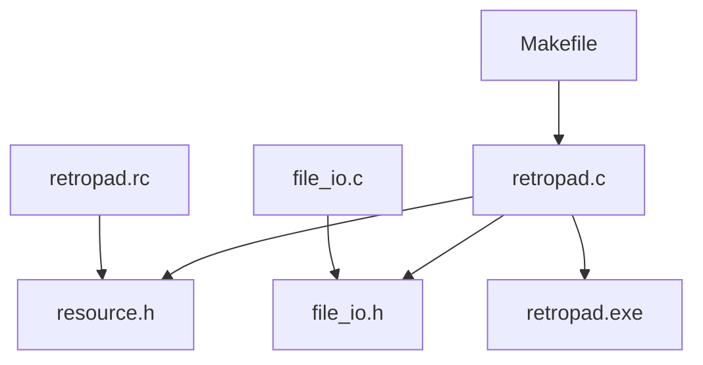

# PlummersSoftwareLLC/retropad

> Clone of Windows Notepad in pure C, to build yourself, without printing.

## The problem
No real need: a stylistic exercise that reproduces classic Notepad in Win32.

## What it actually does
Classic menus and shortcuts, word wrap, status bar, find/replace, font selection, date and time insertion, BOM-aware reading and writing (UTF-8/UTF-16). Printing is deliberately absent. `retropad.c` holds the interface, `file_io.c` the input/output.

## How it is wired


## Trying it
```bat
nmake /f makefile
.\retropad.exe
```
```bash
make
```

## Cost and gotchas
Windows, Visual Studio 2022 with the C++ workload (or MinGW-w64). The README cites a placeholder clone URL (`your/repo`).

## What it is not
Not a code editor. No printing support, by choice.

## Alternatives
No alternative named in the README.

## For you
Ignore: a demonstration Windows application, with no data or AI use.
