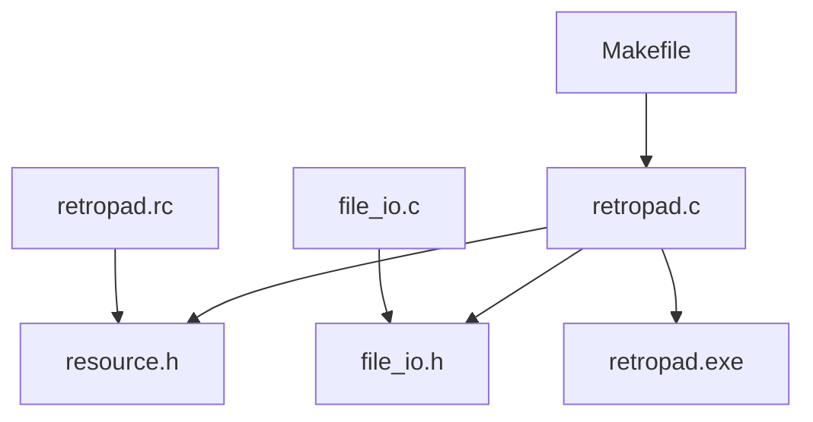

# PlummersSoftwareLLC/retropad

> Clone du Bloc-notes Windows en C pur, à compiler soi-même, sans impression.

## Le problème
Aucun besoin réel : exercice de style qui reproduit le Bloc-notes classique en Win32.

## Ce que ça fait vraiment
Menus et raccourcis classiques, retour à la ligne, barre d'état, rechercher/remplacer, choix de police, insertion de date et d'heure, lecture et écriture conscientes des BOM (UTF-8/UTF-16). L'impression est volontairement absente. `retropad.c` contient l'interface, `file_io.c` les entrées-sorties.

## Comment c'est branché


## Essayer
```bat
nmake /f makefile
.\retropad.exe
```
```bash
make
```

## Coût et pièges
Windows, Visual Studio 2022 avec charge C++ (ou MinGW-w64). Le README cite une URL de clone factice (`your/repo`).

## Ce que ce n'est pas
Pas un éditeur de code. Pas de support d'impression, par choix.

## Alternatives
Aucune alternative nommée dans le README.

## Pour toi
Ignorer : application Windows de démonstration, sans usage data ou IA.

