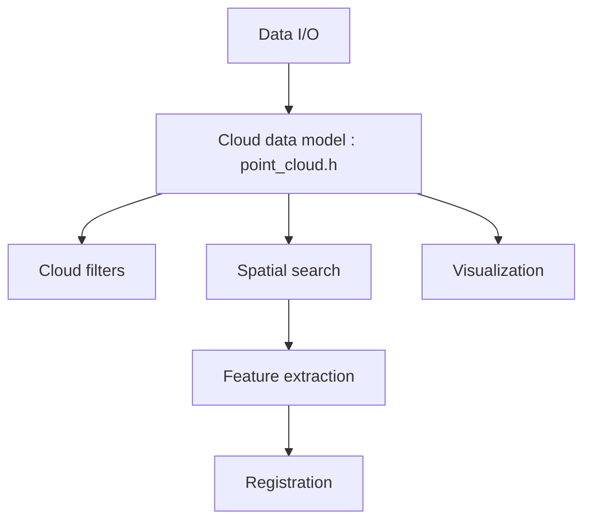

# PointCloudLibrary/pcl

> Open C++ library for processing 3D point clouds and images, for robotics and vision.

## The problem
3D sensor data arrives as millions of raw points, with no standard tools to filter them, align them or extract surfaces from them.

## What it actually does
It loads point clouds from files or sensors (OpenNI2, RealSense). It offers filters, neighbor search, descriptors, registration, segmentation, surface reconstruction and visualization. GPU and CUDA modules exist.

## How it is wired

## Trying it
No install command in the README: it points to per-platform build tutorials (Linux, Mac OS X, Windows).

## Cost and gotchas
Free. It must be compiled in C++; the README points to per-system guides. The license is announced as BSD by the README but GitHub does not identify it: to be verified. The historical website was hacked, according to the README.

## What it is not
It is not a Python library: direct use is in C++. It is not deep learning, despite a machine-learning module.

## Alternatives
No alternative named in the README.

## For you
Keep an eye on it: useful if you do 3D perception or lidar, of no interest for tabular or text tasks.
