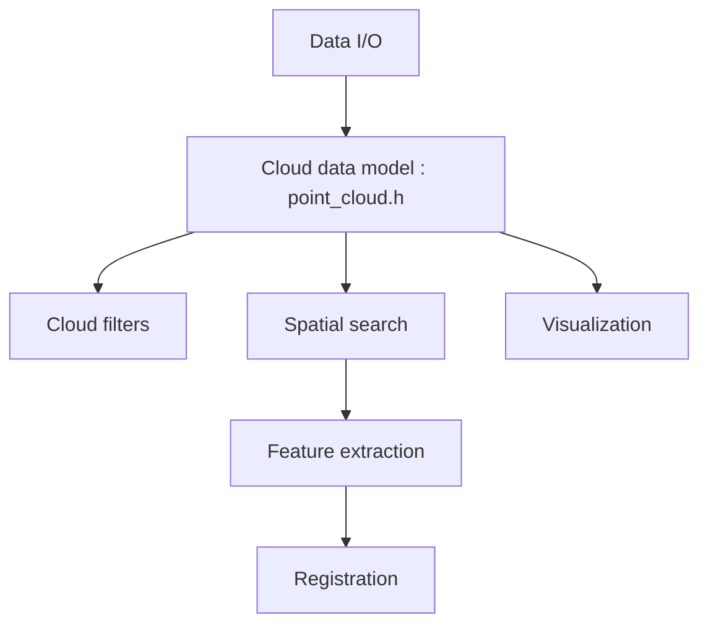

# PointCloudLibrary/pcl

> Bibliothèque C++ ouverte de traitement de nuages de points 3D et d'images, pour la robotique et la vision.

## Le problème
Les données de capteurs 3D arrivent sous forme de millions de points bruts, sans outils standard pour les filtrer, les aligner ou en tirer des surfaces.

## Ce que ça fait vraiment
Elle charge des nuages de points depuis des fichiers ou des capteurs (OpenNI2, RealSense). Elle offre filtres, recherche de voisins, descripteurs, recalage, segmentation, reconstruction de surface et visualisation. Des modules GPU et CUDA existent.

## Comment c'est branché

## Essayer
Aucune commande d'installation dans le README : il renvoie aux tutoriels de compilation par plateforme (Linux, Mac OS X, Windows).

## Coût et pièges
Gratuit. Il faut compiler en C++ ; le README renvoie à des guides par système. La licence est annoncée BSD par le README mais GitHub ne l'identifie pas : à vérifier. Le site historique a été piraté, d'après le README.

## Ce que ce n'est pas
Ce n'est pas une bibliothèque Python : l'usage direct est en C++. Ce n'est pas du deep learning, malgré un module d'apprentissage automatique.

## Alternatives
Aucune alternative nommée dans le README.

## Pour toi
Surveiller : utile si tu fais de la perception 3D ou du lidar, sans intérêt pour des tâches tabulaires ou de texte.

