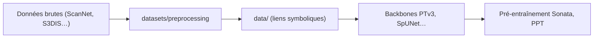

# Pointcept/Pointcept

> Research codebase for 3D point cloud perception (segmentation, pre-training).

## The problem
Comparing 3D architectures (Point Transformer, sparse CNN) on ScanNet, S3DIS or nuScenes requires reimplementing data loading, augmentations and training for each one.

## What it actually does
Brings together in one codebase the backbones (PTv1-v3, MinkUNet, SpUNet, OA-CNNs, Swin3D…), pre-training methods (MSC, PPT, Sonata, Concerto, Utonia) and preprocessing for many datasets (ScanNet, ScanNet++, S3DIS, ArkitScenes, HM3D, Matterport3D, Structured3D). Supports CUDA 11.3+ or ROCm 7. Partial reading: the "Quick Start" part, the Model Zoo and the architecture diagram could not be read.

## How it is wired


## Trying it
```bash
conda env create -f environment.yml --verbose
conda activate pointcept-torch2.5.0-cu12.4
docker run --gpus all -it --rm pointcept/pointcept:v1.6.0-pytorch2.5.0-cuda12.4-cudnn9-devel bash
python pointcept/datasets/preprocessing/scannet/preprocess_scannet.py --dataset_root ${RAW_SCANNET_DIR} --output_root ${PROCESSED_SCANNET_DIR}
```

## Cost and gotchas
An NVIDIA or AMD GPU is mandatory. Several datasets require an access form; Structured3D is 471.7 GB uncompressed. Compiling `libs/pointops` is needed for PTv1/v2. 367 open issues. Card based on a truncated reading.

## What it is not
Not a product or an API: research code to run with configs. Does not cover 2D vision.

## Alternatives
Not documented in the part of the README that was read.

## For you
Watch: a reference if you work in 3D (LiDAR, scans), otherwise off-topic for a generalist data/MLOps profile.
