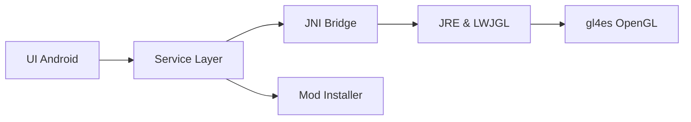

# PojavLauncherTeam/PojavLauncher

> Android and iOS launcher to play Minecraft Java Edition; abandoned project.

## The problem
Minecraft Java Edition does not run natively on mobile.

## What it actually does
Runs an OpenJDK (8, 17, 21) ported to Android with LWJGL and gl4es to translate OpenGL. Handles Forge and Fabric mods, rewritten controls, input in native code. This repository contains the Android part; iOS is in PojavLauncher_iOS.

## How it is wired


## Trying it
```bash
git clone https://github.com/PojavLauncherTeam/PojavLauncher.git
./gradlew :app_pojavlauncher:assembleDebug
```

## Cost and gotchas
Free, LGPL-3.0. Archived repository: the README announces the end of the project and points to a successor. Last push in September 2025.

## What it is not
Not maintained, not supported. Nothing to do with professional use.

## Alternatives
The successor cited by the README (link not named in the text read).

## For you
Ignore: off-topic for data/AI/MLOps, and archived.
