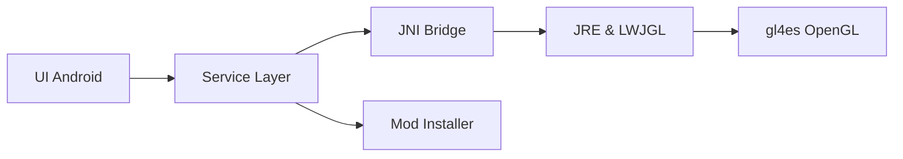

# PojavLauncherTeam/PojavLauncher

> Lanceur Android et iOS pour jouer à Minecraft Java Edition ; projet abandonné.

## Le problème
Minecraft Java Edition ne tourne pas nativement sur mobile.

## Ce que ça fait vraiment
Fait tourner un OpenJDK (8, 17, 21) porté sur Android avec LWJGL et gl4es pour traduire l'OpenGL. Gère mods Forge et Fabric, contrôles réécrits, entrée en code natif. Ce dépôt contient la partie Android ; l'iOS est dans PojavLauncher_iOS.

## Comment c'est branché


## Essayer
```bash
git clone https://github.com/PojavLauncherTeam/PojavLauncher.git
./gradlew :app_pojavlauncher:assembleDebug
```

## Coût et pièges
Gratuit, LGPL-3.0. Dépôt archivé : le README annonce l'arrêt du projet et renvoie vers un successeur. Dernier push en septembre 2025.

## Ce que ce n'est pas
Pas maintenu, pas supporté. Rien à voir avec un usage professionnel.

## Alternatives
Le successeur cité par le README (lien non nommé dans le texte lu).

## Pour toi
Ignorer : hors sujet pour data/IA/MLOps, et archivé.

