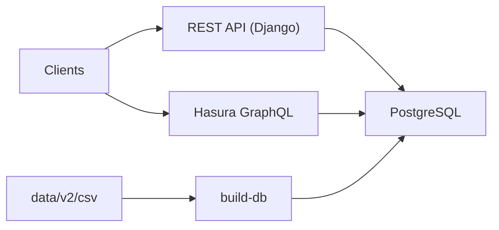

# PokeAPI/pokeapi

> REST (and beta GraphQL) API of Pokémon data, to self-host or consume publicly.

## The problem
Having a rich, stable relational dataset to learn, test, or demo APIs.

## What it actually does
Django application serving `/api/v2/`; the database is rebuilt from CSVs (`make build-db`). Docker Compose and Kubernetes manifests provide PostgreSQL and a Hasura engine for GraphQL; locally, the README mentions SQLite. Official wrappers in several languages.

## How it is wired


## Trying it
```bash
make install
make setup
make serve
make build-db
make docker-setup
```

## Cost and gotchas
Free. Clone with `--recurse-submodules`. The public service handles more than a billion requests per month according to the README: prefer caching or local hosting. Kubernetes deployment: 12 Gi volumes.

## What it is not
Not a dataset for large-scale machine learning: it is a reference of facts about the game. GraphQL is still in beta.

## Alternatives
No alternative named in the README (the listed wrappers are clients).

## For you
Adopt as a demo or exercise source for APIs and relational databases; no business value otherwise.
