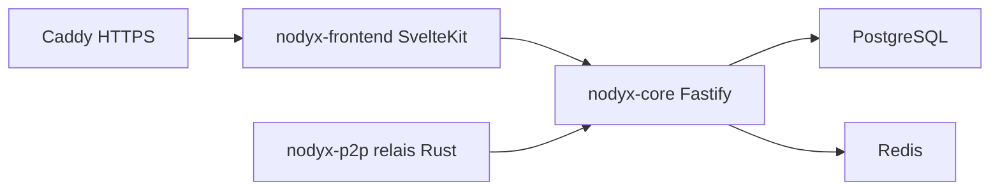

# Pokled/nodyx

> Self-hosted community platform: forum, chat, voice, whiteboard and home page.

## The problem
A community that wants to own its tools depends on silos like Discord, or has to assemble several services.

## What it actually does
A single server provides forum, chat, voice channels with screen sharing, whiteboard, events, polls and a composable home page. The API is in TypeScript (Fastify, Socket.IO), the interface in SvelteKit, the data in PostgreSQL and Redis, and a Rust relay allows hosting behind a home router.

## How it is wired


## Trying it
```bash
curl -fsSL https://nodyx.org/install.sh | bash
sudo nodyx-update
sudo nodyx-doctor
sudo nodyx-recover
```

## Cost and gotchas
Free, but you need an Ubuntu 22.04 or 24.04 or Debian 11 to 13 machine, and you take on security and maintenance. The curl-piped-to-bash installer should be reviewed before running. AGPL-3.0 license: copyleft.

## What it is not
Not a data or AI tool. Large voice rooms still require a publicly reachable server. Project started in February 2026: young.

## Alternatives
- Discourse: preferable for indexed forums.
- Matrix: preferable when interoperability matters most.
- Lemmy: preferable for a federated presence.

## For you
Ignore: a community platform unrelated to data or AI, only of interest for hosting your own community.
