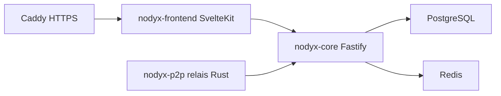

# Pokled/nodyx

> Plateforme communautaire auto-hébergée : forum, chat, voix, tableau blanc et page d'accueil.

## Le problème
Une communauté qui veut posséder ses outils dépend de silos comme Discord, ou doit assembler plusieurs services.

## Ce que ça fait vraiment
Un seul serveur fournit forum, chat, salons vocaux avec partage d'écran, tableau blanc, événements, sondages et page d'accueil composable. L'API est en TypeScript (Fastify, Socket.IO), l'interface en SvelteKit, les données en PostgreSQL et Redis, et un relais Rust permet l'hébergement derrière une box.

## Comment c'est branché


## Essayer
```bash
curl -fsSL https://nodyx.org/install.sh | bash
sudo nodyx-update
sudo nodyx-doctor
sudo nodyx-recover
```

## Coût et pièges
Gratuit, mais il faut une machine Ubuntu 22.04 ou 24.04 ou Debian 11 à 13, et tu assumes sécurité et maintenance. L'installeur par pipe curl vers bash est à relire avant exécution. Licence AGPL-3.0 : copyleft.

## Ce que ce n'est pas
Pas un outil data ni IA. Les grandes salles vocales demandent encore un serveur joignable publiquement. Projet né en février 2026 : jeune.

## Alternatives
- Discourse : à préférer pour des forums indexés.
- Matrix : à préférer quand l'interopérabilité prime.
- Lemmy : à préférer pour une présence fédérée.

## Pour toi
À ignorer : plateforme communautaire sans rapport avec la donnée ou l'IA, intéressante seulement pour héberger ta propre communauté.

