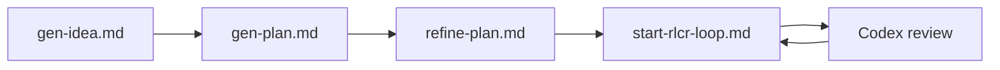

# PolyArch/humanize

> Plugin Claude Code qui boucle implémentation par Claude et revue indépendante par Codex jusqu'à validation du plan.

## Le problème
Un agent qui code seul laisse passer des défauts qu'il ne voit pas ; une revue externe systématique manque.

## Ce que ça fait vraiment
Génère une idée, puis un plan, puis lance une boucle RLCR : Claude implémente, Codex relit les résumés puis le code avec marqueurs de gravité, jusqu'à satisfaction des critères. Options : agent teams, consultation Gemini, suivi par `humanize monitor`, mémoire « Bitter Lesson ». Avant la boucle, vérifie que l'humain comprend le plan.

## Comment c'est branché


## Essayer
```bash
/plugin marketplace add PolyArch/humanize
/plugin install humanize@PolyArch
/humanize:gen-plan --input draft.md --output docs/plan.md
/humanize:start-rlcr-loop docs/plan.md
```

## Coût et pièges
Nécessite le CLI Codex (et Gemini pour la recherche) : consommation d'API des deux fournisseurs à ta charge. Aucune licence déclarée.

## Ce que ce n'est pas
Pas un substitut à la relecture humaine : le projet insiste que l'humain reste l'architecte. L'implémentation interne n'est vérifiée que sur un hook.

## Alternatives
- Plugin ralph-loop officiel, dont il s'inspire.

## Pour toi
À surveiller : idée utile de double regard Claude/Codex, mais pas de licence et usage doublement facturé.

