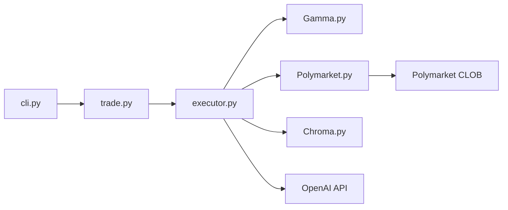

# Polymarket/agents

> Python kit for building AI agents that bet on Polymarket prediction markets.

## The problem
Connecting an LLM, news sources and Polymarket's order API takes a lot of glue.

## What it actually does
A CLI (`scripts/python/cli.py`) and an entry point `agents/application/trade.py` orchestrate an agent creator, an executor and prompts. Connectors cover the Gamma API (market metadata), the Polymarket API (signed orders), Chroma for RAG over news sources, and OpenAI. The whole thing aims at autonomous trading.

## How it is wired


## Trying it
```bash
git clone https://github.com/{username}/polymarket-agents.git
cd polymarket-agents
virtualenv --python=python3.9 .venv
source .venv/bin/activate
pip install -r requirements.txt
cp .env.example .env
python scripts/python/cli.py
```

## Cost and gotchas
`.env` asks for `POLYGON_WALLET_PRIVATE_KEY` and `OPENAI_API_KEY`: a wallet key next to an autonomous agent is a real risk. The wallet must be funded with USDC. The terms of use forbid trading by US residents and other jurisdictions.

## What it is not
Not a proven trading system: no quantified results are given. Archived repository, last push in November 2024, Python 3.9 required.

## Alternatives
No alternative is cited in the README (only CLOB clients, LangChain and Chroma are listed as related repositories).

## For you
Ignore: archived, private key exposed to an agent, legal restrictions; keep it only as an example of an agent + RAG + execution structure.
