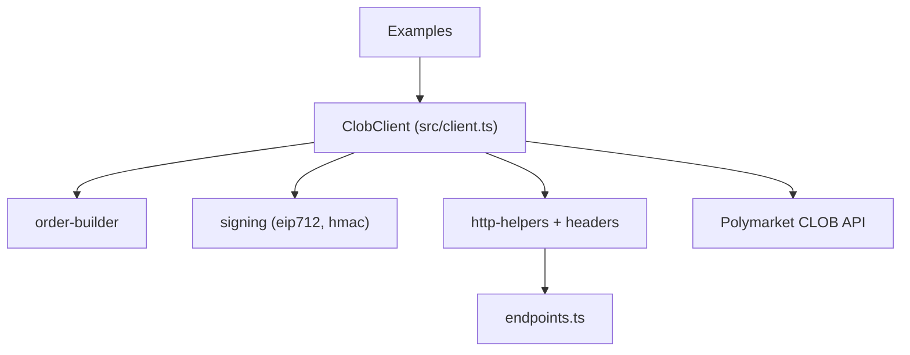

# Polymarket/clob-client

> TypeScript client for placing orders on Polymarket's order book, now archived.

## The problem
Posting signed orders on a central order book means building, signing (EIP-712, HMAC) and sending authenticated requests by hand.

## What it actually does
`ClobClient` assembles the order (order-builder), signs it (signing module), prepares the headers, then calls the CLOB API. It accepts an ethers or viem wallet and can throw typed errors with `throwOnError`.

## How it is wired


## Trying it
```bash
npm install @polymarket/clob-client
npm install ethers
```

## Cost and gotchas
The README states that the client is no longer functional and must not be used for any integration. It required a wallet private key, a Polymarket account and USDC funds.

## What it is not
Not a maintained client: the repo points to the new unified SDK `Polymarket/ts-sdk`.

## Alternatives
Polymarket/ts-sdk, the replacement SDK indicated by the README.

## For you
Ignore: archived and declared non-functional; if the topic interests you, start directly from `ts-sdk`.
