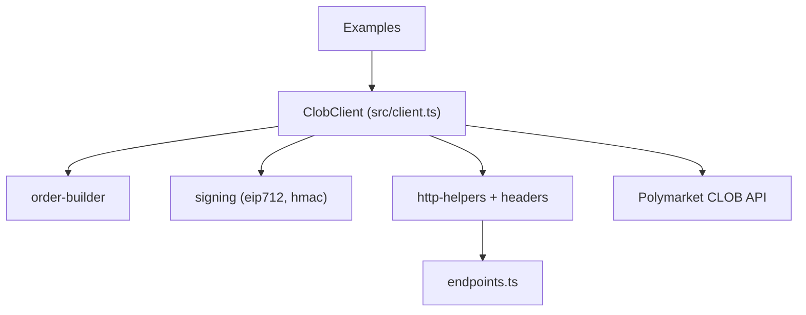

# Polymarket/clob-client

> Client TypeScript pour passer des ordres sur le carnet d'ordres de Polymarket, aujourd'hui archivé.

## Le problème
Poster des ordres signés sur un carnet central demande de construire, signer (EIP-712, HMAC) et envoyer des requêtes authentifiées à la main.

## Ce que ça fait vraiment
`ClobClient` assemble l'ordre (order-builder), le signe (module signing), prépare les en-têtes puis appelle l'API CLOB. Il accepte un wallet ethers ou viem et peut lever des erreurs typées avec `throwOnError`.

## Comment c'est branché


## Essayer
```bash
npm install @polymarket/clob-client
npm install ethers
```

## Coût et pièges
Le README annonce que le client n'est plus fonctionnel et ne doit servir à aucune intégration. Il demandait une clé privée de wallet, un compte Polymarket et des fonds en USDC.

## Ce que ce n'est pas
Pas un client maintenu : le dépôt renvoie vers le nouveau SDK unifié `Polymarket/ts-sdk`.

## Alternatives
Polymarket/ts-sdk, le SDK de remplacement indiqué par le README.

## Pour toi
À ignorer : archivé et déclaré non fonctionnel ; si le sujet t'intéresse, pars directement de `ts-sdk`.

