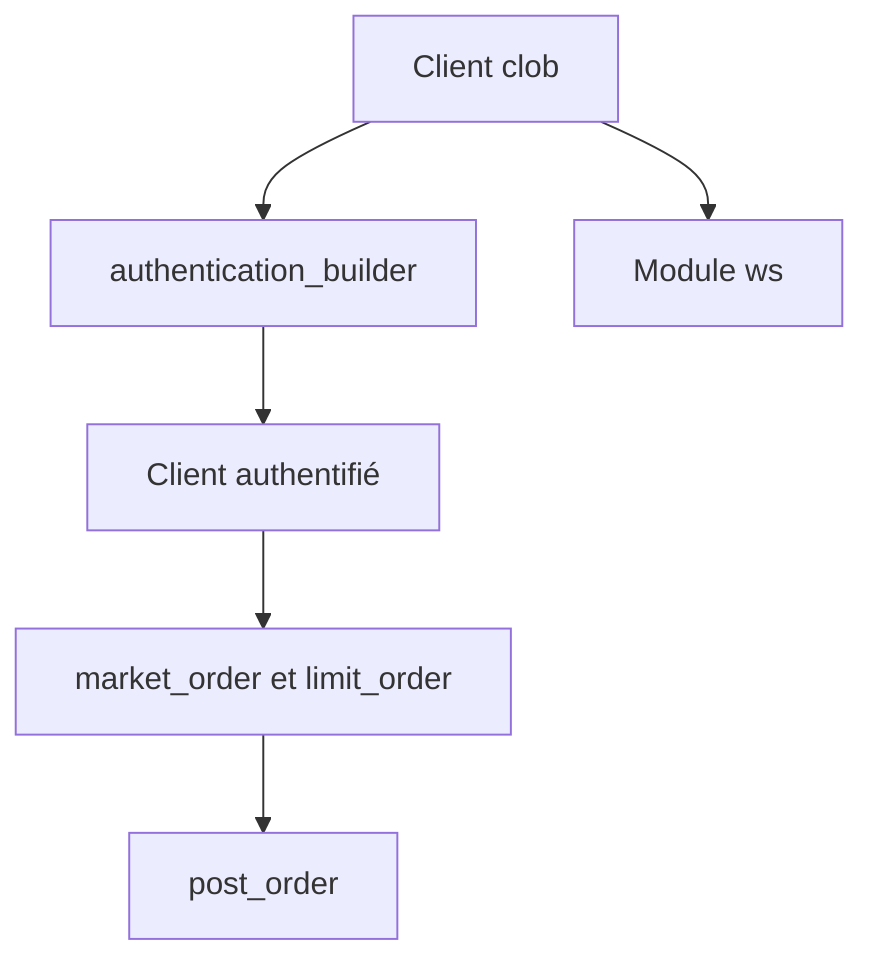

# Polymarket/rs-clob-client

> Typed Rust client for the Polymarket order book, archived in favor of a V2 version.

## The problem
Placing orders and reading Polymarket markets from Rust without rewriting signatures and authentication.

## What it actually does
Typed requests on the CLOB, two authentication flows, signing via alloy, real-time WebSocket, data API, Gamma and deposit bridge. A type-level state machine prevents calling an authenticated endpoint too early. The README states that the client is no longer functional.

## How it is wired
Simplified diagram based on the sheet, no diagram provided.



## Trying it
```bash
cargo add polymarket-client-sdk
cargo run --example unauthenticated
```

## Cost and gotchas
Archived repository: migrate to rs-clob-client-v2. A wallet private key (POLYMARKET_PRIVATE_KEY variable) and token approvals are required to trade; Rust is not in the prerequisites list.

## What it is not
Not a market analysis tool, and no longer a usable client: it can move real money.

## Alternatives
The V2 client: Polymarket/rs-clob-client-v2.

## For you
Ignore: archived and declared non-functional; only look at V2 if you automate prediction markets.
