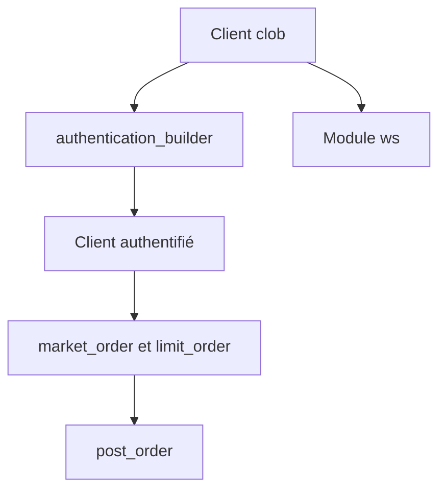

# Polymarket/rs-clob-client

> Client Rust typé pour le carnet d'ordres de Polymarket, archivé au profit d'une version V2.

## Le problème
Passer des ordres et lire les marchés de Polymarket depuis Rust sans réécrire signatures et authentification.

## Ce que ça fait vraiment
Requêtes typées sur le CLOB, deux flux d'authentification, signature via alloy, WebSocket temps réel, API de données, Gamma et pont de dépôts. Une machine à états au niveau des types interdit d'appeler un endpoint authentifié trop tôt. Le README déclare que le client n'est plus fonctionnel.

## Comment c'est branché
Schéma simplifié d'après la fiche, sans diagramme fourni.



## Essayer
```bash
cargo add polymarket-client-sdk
cargo run --example unauthenticated
```

## Coût et pièges
Dépôt archivé : migrer vers rs-clob-client-v2. Une clé privée de portefeuille (variable POLYMARKET_PRIVATE_KEY) et des autorisations de jetons sont requises pour trader ; Rust n'existe pas dans la liste des prérequis.

## Ce que ce n'est pas
Pas un outil d'analyse de marchés, et plus un client utilisable : il peut déplacer de l'argent réel.

## Alternatives
Le client V2 : Polymarket/rs-clob-client-v2.

## Pour toi
À ignorer : archivé et déclaré non fonctionnel ; ne regarder que le V2 si tu automatises des marchés de prédiction.

