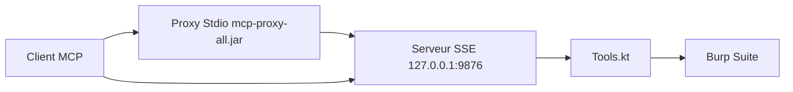

# PortSwigger/mcp-server

> Burp Suite extension that exposes Burp to an AI client via MCP, for web penetration testers.

## The problem
An AI assistant cannot drive Burp Suite (requests, config) without a standardised gateway.

## What it actually does
A Java extension loaded into Burp that starts an SSE MCP server (by default `http://127.0.0.1:9876`). A bundled Stdio proxy lets clients that do not speak SSE, such as Claude Desktop, connect to it, with an automatic installer. Tools are defined in Kotlin in `Tools.kt`; an optional checkbox allows editing the Burp config.

## How it is wired


## Trying it
```bash
git clone https://github.com/PortSwigger/mcp-server.git
cd mcp-server
./gradlew embedProxyJar
```
Then in Burp: Extensions, Add, type Java, `build/libs/burp-mcp-all.jar`.

## Cost and gotchas
Java and the `jar` command in the PATH, Burp Suite installed. Enabling "edit config" gives the AI the power to modify Burp.

## What it is not
Not a standalone testing tool: Burp is required. No documented safeguards on what the AI sends to targets.

## Alternatives
The README names no alternatives.

## For you
Adopt it if you do web security testing with an AI assistant: Burp's vendor maintains it, and the MCP hookup is short.
