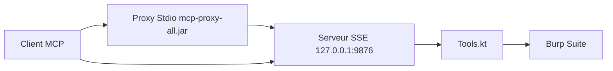

# PortSwigger/mcp-server

> Extension Burp Suite qui expose Burp à un client IA via MCP, pour les testeurs d'intrusion web.

## Le problème
Un assistant IA ne peut pas manipuler Burp Suite (requêtes, config) sans passerelle standardisée.

## Ce que ça fait vraiment
Extension Java chargée dans Burp qui lance un serveur MCP SSE (par défaut `http://127.0.0.1:9876`). Un proxy Stdio fourni permet aux clients qui ne parlent pas SSE, comme Claude Desktop, de s'y brancher, avec un installeur automatique. Les outils sont définis en Kotlin dans `Tools.kt` ; une case optionnelle autorise l'édition de la config Burp.

## Comment c'est branché


## Essayer
```bash
git clone https://github.com/PortSwigger/mcp-server.git
cd mcp-server
./gradlew embedProxyJar
```
Puis Burp : Extensions, Add, type Java, `build/libs/burp-mcp-all.jar`.

## Coût et pièges
Java et la commande `jar` dans le PATH, Burp Suite installé. Activer « edit config » donne à l'IA le pouvoir de modifier Burp.

## Ce que ce n'est pas
Pas un outil de test autonome : il faut Burp. Pas de garde-fous documentés sur ce que l'IA envoie aux cibles.

## Alternatives
Le README ne cite aucune alternative nommée.

## Pour toi
À adopter si tu fais du test de sécurité web avec un assistant IA : l'éditeur de Burp le maintient, et le branchement MCP est court.

