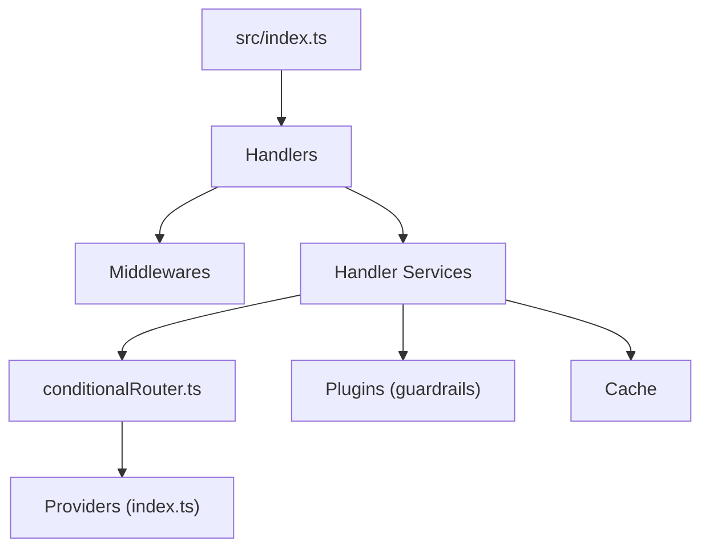

# Portkey-AI/gateway

> Open source gateway that routes an OpenAI-compatible API to many LLMs, for AI teams.

## The problem
Calling several LLM providers means as many clients, with no shared retries, fallback or guardrails.

## What it actually does
Accepts OpenAI-format requests and sends them through provider adapters (OpenAI, Anthropic, Bedrock, Vertex...). "Configs" add retries, fallbacks, load balancing, conditional routing, timeouts, caching (memory, file, Redis, Cloudflare KV) and plugin-based guardrails. A local console displays the logs. Team management, semantic caching and prompt features are reserved for the hosted and enterprise versions.

## How it is wired


## Trying it
```bash
npx @portkey-ai/gateway
```
Gateway at `http://localhost:8787/v1`, console at `http://localhost:8787/public/`.

## Cost and gotchas
Free locally, but you supply the provider keys and pay for their tokens. Several features require the hosted service or the enterprise edition. The README announces a 2.0 version in pre-release.

## What it is not
It is neither a model nor a model host. The latency and volume claims come from the README and are unverified. Last push in May 2026.

## Alternatives
No alternative named in the README.

## For you
Worth watching: a unified LLM gateway is useful in MLOps, but the most interesting features go through the commercial offering.
