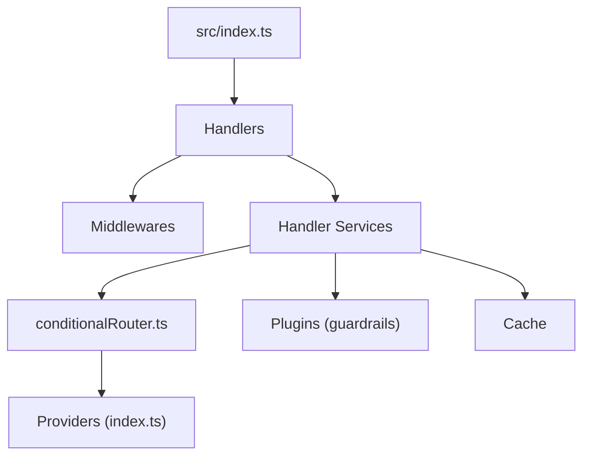

# Portkey-AI/gateway

> Passerelle open source qui route une API compatible OpenAI vers de nombreux LLM, pour équipes IA.

## Le problème
Appeler plusieurs fournisseurs de LLM impose autant de clients, sans reprises, bascule ni garde-fous communs.

## Ce que ça fait vraiment
Accepte des requêtes au format OpenAI et les envoie via des adaptateurs de fournisseurs (OpenAI, Anthropic, Bedrock, Vertex...). Des « configs » ajoutent reprises, bascules, répartition de charge, routage conditionnel, délais, cache (mémoire, fichier, Redis, Cloudflare KV) et garde-fous par plugins. Une console locale affiche les logs. Les fonctions de gestion d'équipe, cache sémantique et prompts sont réservées aux versions hébergée et entreprise.

## Comment c'est branché


## Essayer
```bash
npx @portkey-ai/gateway
```
Passerelle sur `http://localhost:8787/v1`, console sur `http://localhost:8787/public/`.

## Coût et pièges
Gratuit en local, mais tu fournis les clés des fournisseurs et payes leurs tokens. Plusieurs fonctions exigent le service hébergé ou l'édition entreprise. Le README annonce une version 2.0 en pré-version.

## Ce que ce n'est pas
Ce n'est pas un modèle ni un hébergeur de modèles. Les revendications de latence et de volume viennent du README, non vérifiées. Dernier push en mai 2026.

## Alternatives
Aucune alternative nommée dans le README.

## Pour toi
À surveiller : une passerelle LLM unifiée est utile en MLOps, mais les fonctions les plus intéressantes passent par l'offre commerciale.

