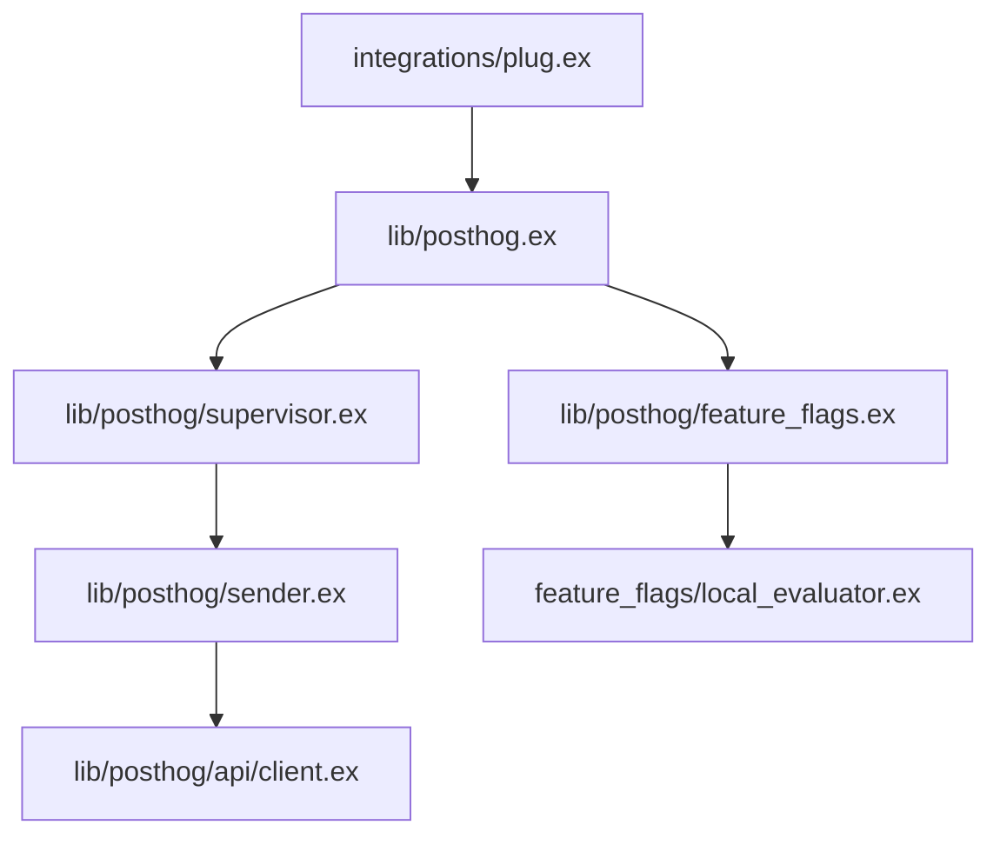

# PostHog/posthog-elixir

> Elixir SDK to send events, evaluate feature flags and track LLM calls to PostHog.

## The problem
Instrumenting an Elixir or Phoenix application for product analytics requires a client suited to the ecosystem.

## What it actually does
The README contains only links to the documentation. From the code: a supervisor starts a sender that ships events to the API client; feature flags can be evaluated locally; a Plug integration and an LLM analytics module are added on top.

## How it is wired

## Trying it
No command documented in the README: see the PostHog documentation.

## Cost and gotchas
A PostHog account is required (free tier then paid, not detailed here). Events are sent to the third-party service.

## What it is not
Not an analytics platform: it is only the Elixir client.

## Alternatives
No alternative named in the README.

## For you
Worth watching: of interest only if you instrument an Elixir application with PostHog, including LLM tracking.
