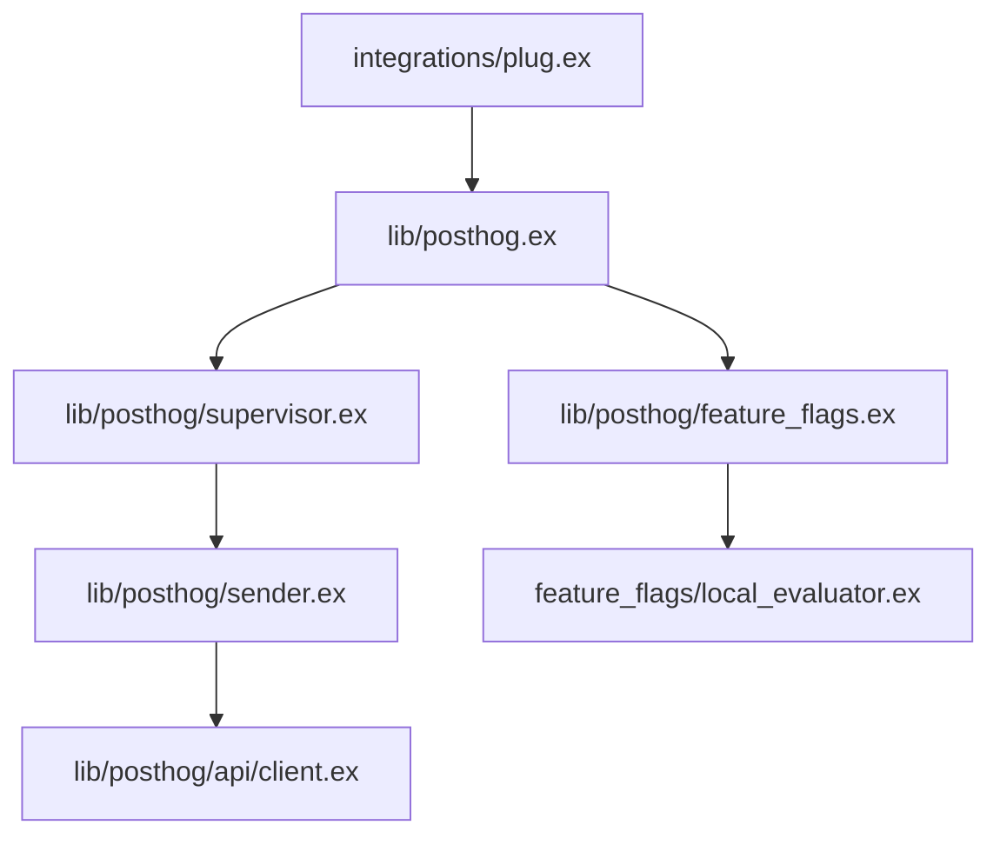

# PostHog/posthog-elixir

> SDK Elixir pour envoyer des événements, évaluer des feature flags et suivre des appels LLM vers PostHog.

## Le problème
Instrumenter une application Elixir ou Phoenix pour l'analytique produit demande un client adapté à l'écosystème.

## Ce que ça fait vraiment
Le README ne contient que des liens vers la documentation. D'après le code : un superviseur démarre un expéditeur qui envoie les événements au client API ; les feature flags peuvent être évalués localement ; une intégration Plug et un module d'analytique LLM s'y ajoutent.

## Comment c'est branché

## Essayer
Aucune commande documentée dans le README : voir la documentation PostHog.

## Coût et pièges
Compte PostHog requis (offre gratuite puis payante, non détaillée ici). Les événements partent vers le service tiers.

## Ce que ce n'est pas
Pas une plateforme d'analytique : c'est seulement le client Elixir.

## Alternatives
Aucune alternative nommée dans le README.

## Pour toi
À surveiller : intéressant seulement si tu instrumentes une application Elixir avec PostHog, y compris le suivi de LLM.

