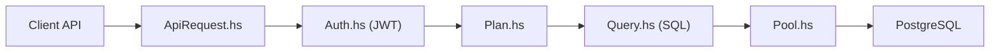

# PostgREST/postgrest

> Serveur qui expose une API REST complète à partir d'une base PostgreSQL existante.

## Le problème
Écrire à la main une API CRUD par-dessus PostgreSQL est long et duplique des règles déjà présentes dans la base.

## Ce que ça fait vraiment
PostgREST analyse la requête, vérifie le jeton JWT, planifie, traduit en SQL (JSON sérialisé directement en SQL), exécute via un pool de connexions et formate la réponse. L'autorisation vient des rôles de la base, le versionnage des schémas, la documentation d'OpenAPI. Il est écrit en Haskell (Warp, Hasql) et sans état.

## Comment c'est branché


## Essayer
```bash
postgrest --help
```

## Coût et pièges
Gratuit. Il faut un PostgreSQL et soigner les rôles et contraintes : la sécurité repose entièrement sur la base. Le README décrit aussi une installation par Docker, sans commande.

## Ce que ce n'est pas
Pas un ORM ni un serveur de logique métier : tout le métier doit vivre dans la base (vues, fonctions, contraintes).

## Alternatives
Aucune alternative nommée dans le README.

## Pour toi
À adopter pour exposer rapidement des tables de features ou de résultats en API, si tu maîtrises les rôles PostgreSQL.

