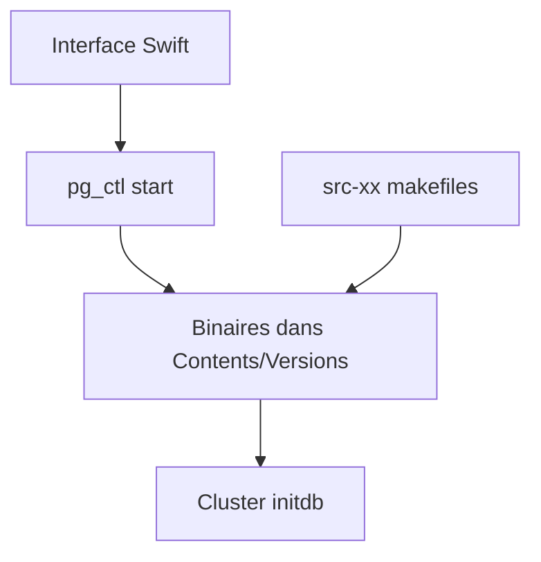

# PostgresApp/PostgresApp

> macOS application that starts PostgreSQL in one click, with PostGIS and pgvector included.

## The problem
Installing several PostgreSQL versions with extensions and making them coexist on a Mac is tedious.

## What it actually does
Postgres.app bundles the PostgreSQL binaries in a macOS package, with a Swift interface to start and stop servers. Several versions run in parallel. Included are PostGIS, pgrouting, wal2json, pldebugger, pgvector (PostgreSQL 15+), plv8 and pljs. On first launch, it initializes a cluster, creates a superuser and a database under your name.

## How it is wired


## Trying it
```bash
make postgresql
make -j 3 postgresql
```
These commands are for compiling the binaries; the download comes from the project's website.

## Cost and gotchas
Free. Building everything (PostGIS, plv8) downloads and builds several gigabytes. The server runs under your user, not under a `postgres` system user. The license is not identified by GitHub.

## What it is not
macOS only; not a server deployment tool nor for production.

## Alternatives
No alternative named in the README.

## For you
Worth adopting if you develop on macOS: PostgreSQL with pgvector ready to use for testing RAG locally.
