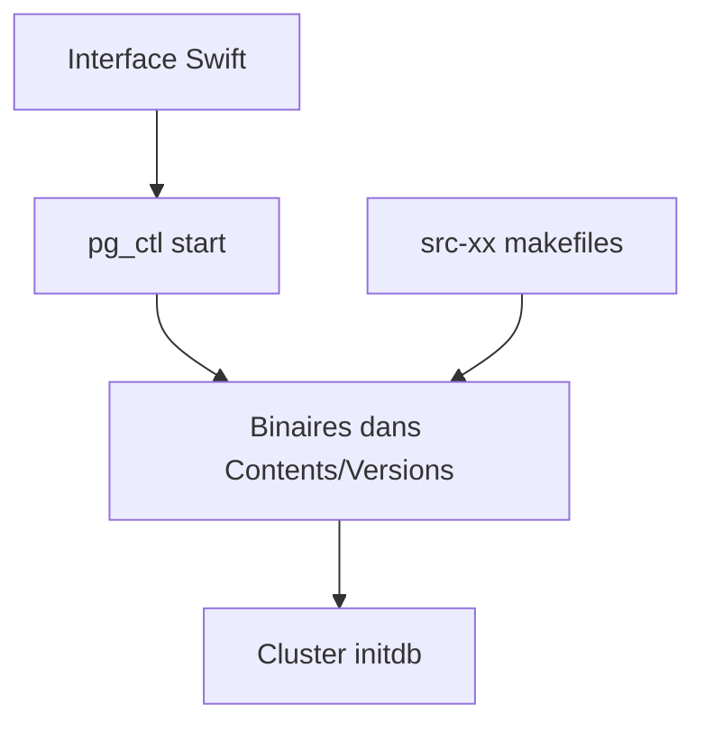

# PostgresApp/PostgresApp

> Application macOS qui lance PostgreSQL en un clic, avec PostGIS et pgvector inclus.

## Le problème
Installer et faire cohabiter plusieurs versions de PostgreSQL avec extensions sur un Mac est fastidieux.

## Ce que ça fait vraiment
Postgres.app embarque les binaires PostgreSQL dans un paquet macOS, avec une interface Swift pour démarrer et arrêter les serveurs. Plusieurs versions tournent en parallèle. Sont inclus PostGIS, pgrouting, wal2json, pldebugger, pgvector (PostgreSQL 15+), plv8 et pljs. Au premier lancement, il initialise un cluster, crée un superutilisateur et une base à ton nom.

## Comment c'est branché


## Essayer
```bash
make postgresql
make -j 3 postgresql
```
Ces commandes servent à compiler les binaires ; le téléchargement se fait depuis le site du projet.

## Coût et pièges
Gratuit. Compiler tout (PostGIS, plv8) télécharge et construit plusieurs gigaoctets. Le serveur tourne sous ton utilisateur, pas sous un utilisateur système `postgres`. La licence n'est pas identifiée par GitHub.

## Ce que ce n'est pas
Réservé à macOS ; pas un outil de déploiement serveur ni de production.

## Alternatives
Aucune alternative nommée dans le README.

## Pour toi
À adopter si tu développes sous macOS : PostgreSQL avec pgvector prêt à l'emploi pour tester du RAG en local.

