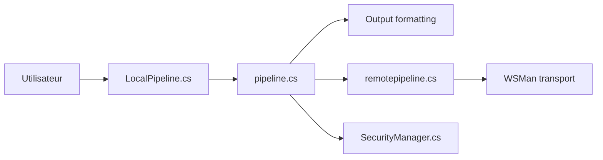

# PowerShell/PowerShell

> Shell is a scripting language developed by Microsoft, designed to automate tasks on structured data and REST APIs.

## The problem
Traditional text parsing methods require the use of regular expressions to process text whenever you work with JSON, CSV, XML, or REST APIs.

## What it actually does
Provides an online command-line shell, a scripting language, and a framework of cmdlets. Commands exchange objects rather than text. Runs on Windows, Linux, and macOS. This repository only covers PowerShell 7+, not Windows PowerShell 5.1.

## How it is wired


## Trying it
```bash
git clone https://github.com/PowerShell/PowerShell.git
```
Installation and compilation: docs/building/linux.md, windows-core.md, macos.md (details not provided in the README).

## Cost and gotchas
Free. The Docker images `mcr.microsoft.com/powershell` are no longer maintained (taken over by the .NET team). Telemetry is available, as described in about_Telemetry.

## What it is not
Not Windows PowerShell 5.1: the updates included in this release do not include it. The README only provides links, not installation instructions.

## Alternatives
No alternative is specified in the README.

## For you
Things to watch out for: Useful for scripting in a Windows/Azure environment, but a Linux data/MLOps profile is sufficient with bash and Python.
