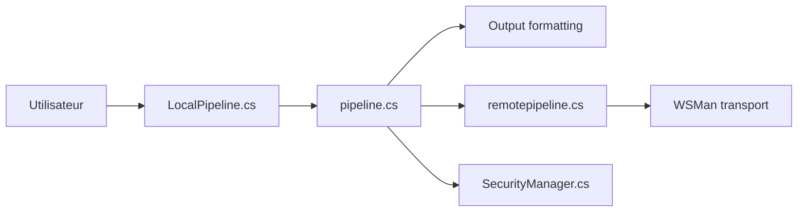

# PowerShell/PowerShell

> Shell et langage de script multiplateforme de Microsoft, pensé pour automatiser sur des données structurées et des API REST.

## Le problème
Les shells texte classiques obligent à parser du texte à coups de regex dès qu'on manipule JSON, CSV, XML ou des API REST.

## Ce que ça fait vraiment
Fournit un shell en ligne de commande, un langage de script et un framework de cmdlets. Les commandes échangent des objets plutôt que du texte. Tourne sur Windows, Linux et macOS. Ce dépôt ne couvre que PowerShell 7+, pas Windows PowerShell 5.1.

## Comment c'est branché


## Essayer
```bash
git clone https://github.com/PowerShell/PowerShell.git
```
Installation et compilation : docs/building/linux.md, windows-core.md, macos.md (non détaillées dans le README).

## Coût et pièges
Gratuit. Les images Docker `mcr.microsoft.com/powershell` ne sont plus maintenues (reprises par l'équipe .NET). Une télémétrie existe, décrite dans about_Telemetry.

## Ce que ce n'est pas
Pas Windows PowerShell 5.1 : les correctifs d'ici n'y sont pas portés. Le README ne donne pas de commande d'installation, seulement des liens.

## Alternatives
Aucune alternative nommée dans le README.

## Pour toi
À surveiller : utile pour scripter en environnement Windows/Azure, mais un profil data/MLOps Linux se contente de bash et Python.

