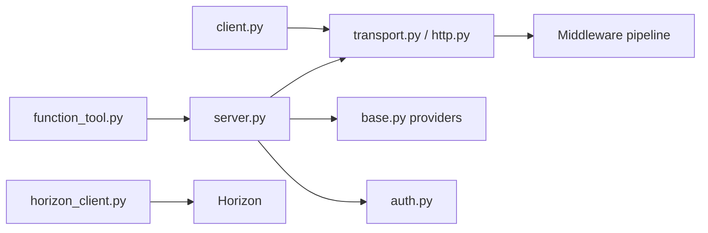

# PrefectHQ/fastmcp

> A Python framework for writing MCP servers, clients and apps from plain functions.

## The problem
Implementing the MCP protocol by hand (schemas, transports, authentication, lifecycle) is long and error-prone.

## What it actually does
A `@mcp.tool` decorator turns a Python function into a typed MCP tool (schema and validation generated).
Server: stdio/HTTP transports, middleware (auth, cache, rate limit), providers (local, proxy, OpenAPI), transforms.
Client: discovery, calls, OAuth, Anthropic/OpenAI/Gemini sampling handlers.
Companion packages: remote CLI, durable tasks; optional deployment to Horizon (Prefect SaaS).

## How it is wired


## Trying it
```bash
uv add fastmcp
```

## Cost and gotchas
Free (Apache-2.0). Horizon is a paid enterprise offering, not required. Several major versions: follow the migration guides.

## What it is not
Not the official MCP SDK (although v1 was integrated into it). Not an enterprise gateway: that is Horizon's role.

## Alternatives
- FastMCP for TypeScript (@prefecthq/fastmcp-ts): same approach on the Node side.

## For you
Adopt: the shortest path to expose your data tools or your models to Claude via MCP, in a few lines of Python.
