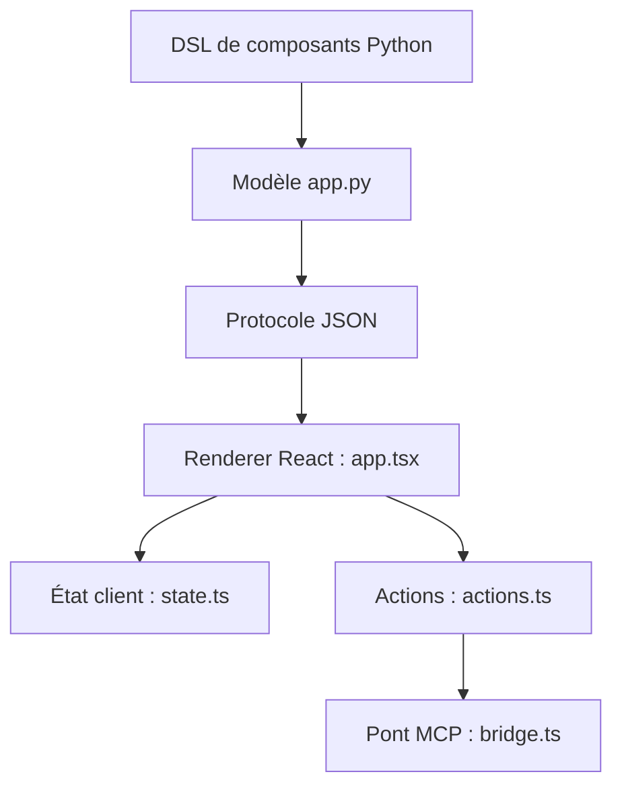

# PrefectHQ/prefab

> Python framework to compose interactive interfaces, including MCP applications and dashboards.

## The problem
Shipping a dashboard or a form alongside a Python server forces you to write a frontend in another language.

## What it actually does
You declare the interface in Python with context managers and more than 100 components. The tree is serialized to JSON then rendered by a React frontend based on shadcn/ui. Reactive client-side state avoids JavaScript. It is integrated with FastMCP and accepts interfaces generated by an agent.

## How it is wired


## Trying it
```bash
pip install prefab-ui
```
```python
from prefab_ui.components import *
from prefab_ui.rx import Rx
name = Rx("name").default("world")
with Card():
    with CardContent():
        Input(name="name", placeholder="Your name...")
```

## Cost and gotchas
Free. Python 3.10 minimum. The README warns of very active development: the API may change.

## What it is not
Not a statistical visualization tool: it is an interface framework. The author specifies that you assemble existing components, without creating any in Python.

## Alternatives
- FastUI: source of inspiration for the declarative protocol.
- FastMCP: MCP framework into which Prefab is integrated.

## For you
Worth watching: handy for giving an MCP tool or a dashboard an interface in pure Python, but the API is still moving.
