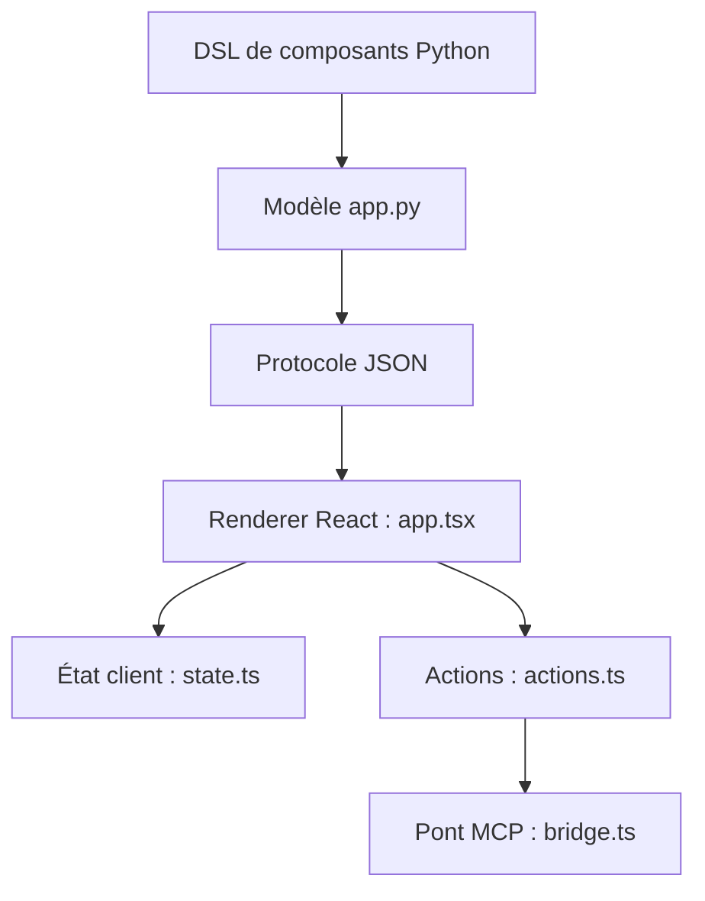

# PrefectHQ/prefab

> Framework Python pour composer des interfaces interactives, y compris des applications MCP et des tableaux de bord.

## Le problème
Livrer un tableau de bord ou un formulaire à côté d'un serveur Python oblige à écrire un frontend dans un autre langage.

## Ce que ça fait vraiment
On déclare l'interface en Python avec des gestionnaires de contexte et plus de 100 composants. L'arbre est sérialisé en JSON puis rendu par un frontend React basé sur shadcn/ui. Un état réactif côté client évite le JavaScript. Il est intégré à FastMCP et accepte des interfaces générées par un agent.

## Comment c'est branché


## Essayer
```bash
pip install prefab-ui
```
```python
from prefab_ui.components import *
from prefab_ui.rx import Rx
name = Rx("name").default("world")
with Card():
    with CardContent():
        Input(name="name", placeholder="Your name...")
```

## Coût et pièges
Gratuit. Python 3.10 minimum. Le README prévient d'un développement très actif : l'API peut changer.

## Ce que ce n'est pas
Pas un outil de visualisation statistique : c'est un cadre d'interface. L'auteur précise qu'on assemble des composants existants, sans en créer en Python.

## Alternatives
- FastUI : source d'inspiration du protocole déclaratif.
- FastMCP : cadre MCP auquel Prefab est intégré.

## Pour toi
À surveiller : pratique pour donner une interface à un outil MCP ou un tableau de bord en Python pur, mais l'API bouge encore.

