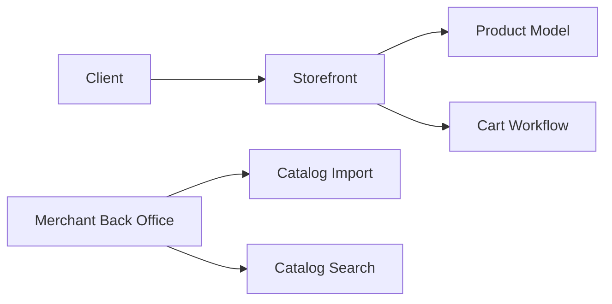

# PrestaShop/PrestaShop

> Open source online commerce application in PHP, with storefront and back office.

## The problem
Setting up a multilingual online shop with payments, without developing a commerce platform.

## What it actually does
Storefront (catalog, product pages, cart) and merchant back office (catalog import, search engines, stock, taxes). Extensible through modules and themes. This repository is intended for development: the stable version is downloaded from the releases page; the `develop` branch prepares 9.1.

## How it is wired


## Trying it
```bash
make docker-start
```
Storefront at http://localhost:8001, admin at http://localhost:8001/admin-dev.

## Cost and gotchas
Free. PHP 8.1+ and MySQL 5.6+. The default demo credentials are public: change them via `ADMIN_MAIL` and `ADMIN_PASSWD`. License not identified by GitHub: to be checked.

## What it is not
Not hosting: plan for a web server, a database and securing the back office.

## Alternatives
No alternative named in the README.

## For you
Ignore: online commerce is outside the data/AI/MLOps scope.
