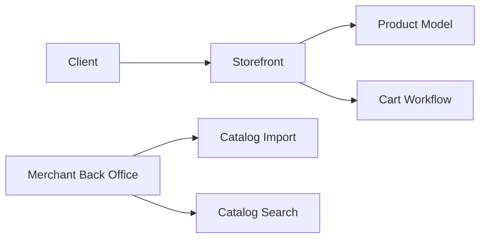

# PrestaShop/PrestaShop

> Application de commerce en ligne open source en PHP, avec boutique et back-office.

## Le problème
Monter une boutique en ligne multilingue avec paiements, sans développer une plateforme de commerce.

## Ce que ça fait vraiment
Vitrine (catalogue, fiches produits, panier) et back-office marchand (import de catalogue, moteurs de recherche, stock, taxes). Extensible par modules et thèmes. Ce dépôt est destiné au développement : la version stable se télécharge sur la page de releases ; la branche `develop` prépare la 9.1.

## Comment c'est branché


## Essayer
```bash
make docker-start
```
Vitrine sur http://localhost:8001, admin sur http://localhost:8001/admin-dev.

## Coût et pièges
Gratuit. PHP 8.1+ et MySQL 5.6+. Les identifiants de démonstration par défaut sont publics : à changer via `ADMIN_MAIL` et `ADMIN_PASSWD`. Licence non identifiée par GitHub : à vérifier.

## Ce que ce n'est pas
Pas un hébergement : prévois serveur web, base et sécurisation du back-office.

## Alternatives
Aucune alternative nommée dans le README.

## Pour toi
Ignorer : le commerce en ligne est hors du périmètre data/IA/MLOps.

