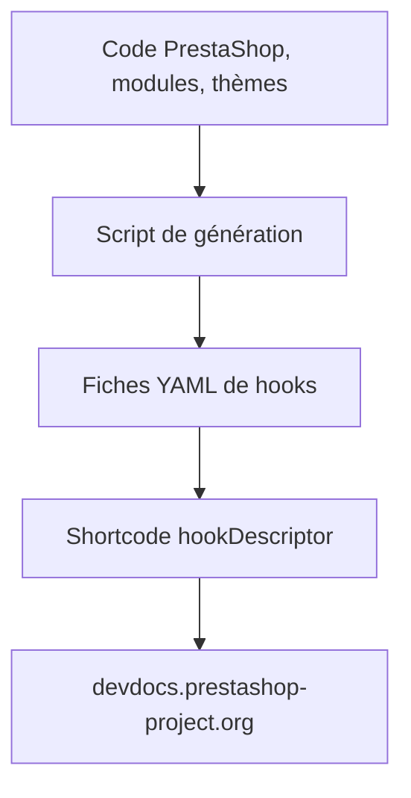

# PrestaShop/docs

> Sources of the PrestaShop technical documentation, published at devdocs.prestashop-project.org.

## The problem
PrestaShop module and theme developers need an up-to-date reference.

## What it actually does
Repository of the developer documentation pages. The README mostly describes the hook list: a script walks through the core, modules and native themes, and each hook is described in YAML. A `hookDescriptor` shortcode generates its HTML page. Site rendering and deployment live in the `devdocs-site` repository.

## How it is wired
Simplified diagram based on the sheet, no diagram provided.



## Trying it
```bash
# Aucune commande documentée ; le rendu local est décrit dans PrestaShop/devdocs-site
```

## Cost and gotchas
Free. License not identified by GitHub. 126 open issues.

## What it is not
Not a tool or a library: only the documentation of an e-commerce product.

## Alternatives
None mentioned in the README.

## For you
Ignore: documentation for an e-commerce CMS, unrelated to a data / AI / MLOps profile.
