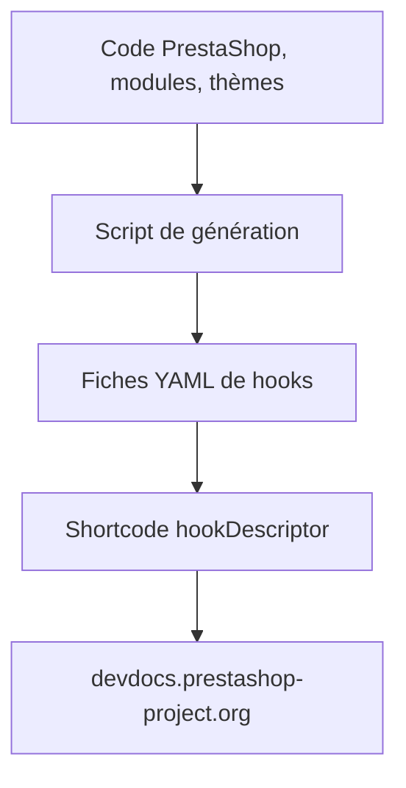

# PrestaShop/docs

> Sources de la documentation technique de PrestaShop, publiée sur devdocs.prestashop-project.org.

## Le problème
Les développeurs de modules et de thèmes PrestaShop ont besoin d'une référence à jour.

## Ce que ça fait vraiment
Dépôt des pages de la documentation pour développeurs. Le README décrit surtout la liste des hooks : un script parcourt le cœur, les modules et les thèmes natifs, et chaque hook est décrit en YAML. Un shortcode `hookDescriptor` en génère la page HTML. Le rendu du site et le déploiement sont dans le dépôt `devdocs-site`.

## Comment c'est branché
Schéma simplifié d'après la fiche, sans diagramme fourni.



## Essayer
```bash
# Aucune commande documentée ; le rendu local est décrit dans PrestaShop/devdocs-site
```

## Coût et pièges
Gratuit. Licence non identifiée par GitHub. 126 issues ouvertes.

## Ce que ce n'est pas
Pas un outil ni une bibliothèque : seulement la documentation d'un produit e-commerce.

## Alternatives
Aucune citée dans le README.

## Pour toi
Ignorer : documentation d'un CMS e-commerce, sans rapport avec un profil data / IA / MLOps.

