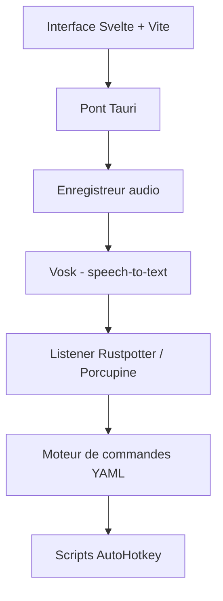

# Priler/jarvis

> Offline desktop voice assistant, in Rust and Tauri, to run commands by voice.

## The problem
Mainstream voice assistants go through the cloud and collect data; a local, open assistant with no collection remains rare.

## What it actually does
The Rust backend records audio, converts it to text with Vosk, detects the wake word (Rustpotter in progress, or Picovoice Porcupine with an API key) and then runs the matching command. Each command has a YAML file and AutoHotkey scripts (browser, volume, Steam, etc.). The interface is in Svelte via Tauri. The README states it is outdated and that the NLU and chat part does not exist yet.

## How it is wired


## Trying it
```bash
cargo tauri dev
cargo tauri build
```
Rust and NodeJS must be installed, with platform-specific libraries for PvRecorder and Vosk.

## Cost and gotchas
Free. Porcupine requires an API key; Vosk as a wake word is "very slow" according to the README. The AutoHotkey scripts point to a Windows-oriented use. License present but not identified: to be checked.

## What it is not
It is not a conversational assistant: no NLU, no active LLM (ChatGPT "soon"). It is not a stable version: the README itself says it is obsolete.

## Alternatives
No alternative named in the README.

## For you
Worth watching: an interesting starting point for local voice (STT, wake word), but an outdated README, missing NLU and a single author.
